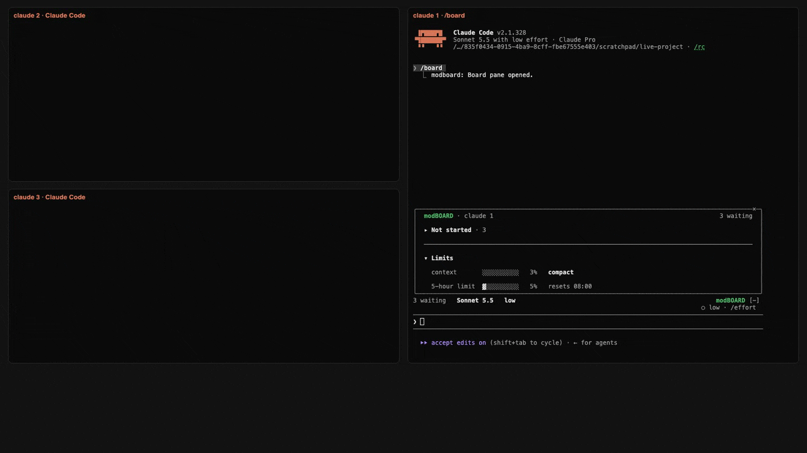

<h1 align="center">modboard</h1>

<p align="center">
  
  
  <a href="https://www.npmjs.com/package/modboard"></a>
  
</p>

<p align="center">
  A task board several coding agents share at once. Two Claude Code sessions, a Codex session and a person can all claim tasks from it, see who holds what, and hand unfinished work to each other without losing context. One claim wins, a crashed agent's work comes back on its own, and nothing is marked done without saying how it was checked.<br/><br/>
  Works with <a href="#claude-code">Claude Code</a>, <a href="#codex-opencode-or-any-agent-with-a-shell">Codex</a>, <a href="#codex-opencode-or-any-agent-with-a-shell">OpenCode</a>, and <a href="#codex-opencode-or-any-agent-with-a-shell">anything with a shell</a>, a person included.
</p>

---

<p align="center">
  <a href="docs/TUTORIAL.md">Tutorial</a> • <a href="#see-it-in-action">Demo</a> • <a href="#install">Install</a> • <a href="#usage">Usage</a> • <a href="#how-it-fits-together">How it fits together</a> • <a href="#what-you-see">What you see</a> • <a href="#make-your-own-block">Make your own block</a> • <a href="#what-has-been-tested">Tested</a> • <a href="#project-structure">Project structure</a> • <a href="#known-limitations">Limitations</a> • <a href="#contributing">Contributing</a>
</p>

---

## See it in action



Three real Claude Code sessions, recorded live at real speed. Only idle
stretches are cut: the wait before the sessions start, and two short pauses
while they wrote their final summaries.
`frontend` and `backend` are each told to work the board, and `viewer` has
`/board` open. Both go for T-001. `frontend` wins, and `backend` is refused
and takes T-002. `frontend` writes part of T-003, then hands it off. The band
above its prompt says "T-003 stopped partway". `backend` reads
the handoff, finishes T-003, and the pane ends on "3 done".

What each part of the screen means: [what you see](#what-you-see).

---

## Install

New here? The [tutorial](docs/TUTORIAL.md) walks you from install to two
agents sharing a board, your task.md on it, and every button, in about
fifteen minutes.

| Agent | How |
|-------|-----|
| Claude Code | `claude --plugin-dir /path/to/modboard` ([steps](#claude-code)) |
| Codex, OpenCode, a shell | put `board` on your PATH and the protocol in `AGENTS.md` ([steps](#codex-opencode-or-any-agent-with-a-shell)) |
| A person | the same `board` CLI |

### The CLI

Every agent goes through it, Claude Code included:

```bash
git clone https://github.com/Magithar/modboard.git
cd modboard && npm link        # puts `board` on your PATH
```

Or from npm: `npm install -g modboard` puts `board` on your PATH, or
`npm install --save-dev modboard` inside a project, then `npx board ...`.

### Claude Code

```bash
claude --plugin-dir /path/to/modboard
```

The board names the session by what it runs and when it joined: the first
is `claude 1`, the next `claude 2`. The `/board` pane's top line says which
one it is. The session gets the board's tools, a line above the prompt and
the pane. To choose a name instead, start it with
`BOARD_AGENT=frontend`.

> **Early access.** The Claude Code mod uses Claude Code's function-hooks API,
> which is early access and can change between releases. It needs Claude Code
> **2.1.295 or newer**. The CLI has no such dependency.

### Codex, OpenCode, or any agent with a shell

Codex needs no name: it marks every shell it runs with its thread, and the
board names each thread by when it joined, `codex 1`, then `codex 2`. Any
other agent gives each session its own name with `export BOARD_AGENT=opencode`.
Then put this protocol in its instructions (`AGENTS.md`):

> Claim a task before working on it. Note progress. If you stop without
> finishing, release it with a handoff. Never touch a task another agent holds.

---

## Usage

```bash
export BOARD_AGENT=frontend               # your name; Codex and Claude need none
board list                                # ○ todo  ◐ claimed  ● done
board show T-001                          # description, notes, handoffs
board claim T-001                         # exit 6 if another agent holds it
board note T-001 "what changed"           # also renews your lease
board heartbeat                           # renew all your leases
board release T-001 --handoff "done X; left Y; see Z"
board done T-001 --note "ran X, saw Y"    # required: how you verified it
board release-all                         # free everything you hold
board add "title" --desc "..." --accept "how to tell it is done"
board agents                              # live agents
board view                                # every task and live agent, as JSON
board doctor                              # ledger vs state
board taskfile                            # the project's task.md, read only
```

Each command answers in a line or two for a person (`claimed T-001 … it's
yours until 14:05`); `--json` prints the data instead, for scripts. `view`
and `events` are for programs and always print JSON. Exit codes: 2 usage, 3 board busy, 4 no such
task, 5 not yours, 6 held by another agent, 7 name in use.

**Claude Code** gets these tools: `board_list`, `board_show`, `board_add`,
`board_claim`, `board_note`, `board_release` and `board_done`. Tool activity
renews the session's leases.

The CLI and the tools keep the board's precise terms (claim, release,
handoff, lease) because agents act on them. The display uses plain words
instead, so you can read it without learning those terms.

---

## How it fits together


One zero-dependency Node CLI owns all state. The Claude Code mod is an
adapter over that CLI. It adds what only Claude Code's host can provide: the
session's identity, a heartbeat on every tool call, and a live pane. Any
other agent uses the same CLI directly.

- **Storage is a block.** The engine never touches files. It reads a snapshot
  from a Store and commits conditional writes ("only if this task is still at
  the version I read"). Any backend that can do that atomically can hold a
  board. See [Make your own block](#a-storage-block-an-adapter).
- **Where the board lives:** `.modboard/` next to the git *common* dir, so
  every worktree of a repo shares one board. Set `BOARD_DIR` to override it.
  Add `.modboard/` to `.gitignore`, because it is runtime state. A board made
  before the rename, in `.agent-board/`, keeps working where it is.
- **Claims:** one lock per board (an atomic `mkdir`). The state file is
  replaced with an atomic rename. Exactly one claimant wins, and only the
  owner can note, release or finish a task.
- **Leases:** a claim lasts 15 minutes (`BOARD_LEASE_MS`). `heartbeat` or
  `note` renews it. An expired claim goes back to todo, and the ledger records
  it, so an agent that crashed doesn't hold a task forever. A Claude session
  pings the board every minute while it is open, so if one is killed outright
  its claims go back after 3 minutes of silence (`BOARD_PRESENCE_MS`), not 15.
  An agent that never ran `board register` (a plain shell) keeps the lease
  alone.
- **Names:** the board names a session by what it runs and when it joined:
  `claude 1`, `claude 2`, `codex 1`. A session keeps its name while it is
  open; once it ends, the next new session takes the lowest free number.
  Codex sends no presence ping, so its name and claims last as long as its
  leases. To choose a name, start a session with `BOARD_AGENT=frontend`. If
  another live session already holds it, the new one becomes `frontend-2`
  and gets a toast explaining why.
- **Handoffs:** `release --handoff "..."` leaves a note that the next agent
  reads with `show` before it continues. When a Claude session ends (exit,
  `/clear`, resume, logout), the mod releases everything that session holds,
  with an automatic handoff. That matters because a restarted session comes
  back with a new identity.
- **Done means verified:** `done` needs a `--note` saying how the task was
  checked, against its `--accept` criteria if it has any.
- **Ledger:** every change is appended to `ledger.jsonl`, including lost
  claims (`claim-rejected`, with the holder). `board doctor` checks that the
  ledger and the state agree.

---

## What you see

The display shows only what needs you. Everything else waits until you ask.

**One line above the prompt**, always visible while there's work on the board:

![The line above the prompt: 2 waiting · 1 active in green, T-005 in a yellow box, Sonnet 5.5, low, and modBOARD in green at the right end beside Claude Code's [-]](docs/band.png)

`1 active` is green: work is moving. `T-005` in a yellow box (`[T-005]`
below) is unfinished: someone stopped it partway and left a handoff. Up to
three boxes, then `+N`. A box
is a button: click it to open `/board` at the Unfinished group, and click
again to fold the group. The 5-hour limit and the context live in the
`/board` pane; add `usage` or `compact` to the band setting to bring them
back to the line.

The line never wraps, and stays clear of Claude Code's own `[-]` control at
its right end. In a narrow window its parts shorten first, then the
last ones drop off. The first block (the summary) keeps its full form longest,
and the alert outlasts the counts:

```
 66 cols   2 waiting · 1 active   [T-005]   Sonnet 5.5   low   modBOARD
 60 cols   2 waiting · 1 active   [T-005]   Sonnet 5.5   modBOARD
 48 cols   2 waiting · 1 active   [T-005]   modBOARD
 36 cols   2 waiting · 1 active   [T-005]
 20 cols   [T-005]
```

The boxes name the one thing that needs you: a task someone stopped partway
that nobody has picked up. A claim gone idle stays off the line, since its
lease frees it on its own; the pane marks it `idle`. If the board stops answering (the `board` CLI fails), the pane says so at
the top in red, `board not updating: …`, until it answers again. The 5-hour limit is a bar, shown once it passes half.
The context is a bar of its own, and clicking it compacts the
conversation, as `/compact` does. Both are plain with room left, yellow from 70% and red from
90%. Click the model or effort to switch to the next one. With nothing
waiting or in progress, the line disappears.

**`/board`** opens the full pane:

```
 modBOARD · claude 1               13 waiting · 3 active

 ▾ In progress · 3

   T-004  Add a test script                          you
   T-007  Write the README                       backend
   T-006  Add a LICENSE file                codex 1 · idle

 ▾ Unfinished · 1

   T-005  Ghost task                            frontend
          · layout done
          · saving isn't wired yet

 ▸ Not started · 12

 ▸ Done · 3

 ───────────────────────────────────────────────────────

 ▸ To do · 4 open   P0

 ───────────────────────────────────────────────────────

 ▾ Limits

   context       ▓▓▓▓▓▓▓░░░  72%   compact

   5-hour limit  ▓▓▓▓▓▓░░░░  64%   resets 12:00
```

The pane shows what needs you and keeps the rest one click away. Each group's
heading is a button with its count: In progress and Unfinished start
open, because they need you, and Not started starts closed, so the whole
board fits without scrolling. Click a heading to
open or close it. The heading says what's happening, so a row only names
who: no marks, no repeated phrases. If the pane is shorter than the board,
its body scrolls with the mouse wheel. Opened, a group shows every task in it. The bars sit
under **Limits**, which folds the same way; folded, it keeps their figures:
`▸ Limits · context 72% · 5-hour 64%`. Colour appears only when
something asks for you: a warning, or a limit past 70%.

Both are stacks of display blocks, chosen in the plugin's settings (`/config`)
as comma-separated lists, in order:

| Block | Band | Pane | Shows |
|---|---|---|---|
| `summary` | ✓ | | what's waiting and active (green), and the one thing left partway (yellow) |
| `board` | ✓ | | `modBOARD`, bold in the logo's green, a plain button that opens the `/board` pane, and closes it when it's open. It sits at the line's right end, by Claude Code's `[-]`, and on a short line outlasts everything but the summary |
| `tasks` | | ✓ | in progress, unfinished, not started and done, each a heading you click to open or close |
| `taskfile` | | ✓ | the project's `task.md`: how much is open; click it to see what's left, and click its priority to turn it |
| `usage` | ✓ | ✓ | the 5-hour limit as a bar: in the band past 50%, in the pane with its reset. The weekly limit is left out (`/usage` has it) |
| `compact` | ✓ | ✓ | the context window as a bar, like the 5-hour limit's, and a button that compacts the conversation. Always in the pane; in the band once Claude Code reports the context |
| `model` | ✓ | ✓ | the session's model; click it to switch to the next one. |
| `effort` | ✓ | ✓ | the effort level; click it to step to the next one, wrapping from the highest to the lowest. |
| `clock` | ✓ | ✓ | the time |
| `context` | ✓ | ✓ | context fill and the session's cost |
| `agents` | | ✓ | who is live on the board |

The defaults are `band: summary,model,effort,board` and `pane: tasks,taskfile,compact,usage`.

**task.md.** If the checkout has a `task.md`, `tasks.md` or `todo.md` (in
any case) at its root or in `docs/`, the pane shows one quiet line,
`To do`, with how much of it is open. Click it to see what's left, under a
dim line naming the file it came from.

When the file has priorities, a second button turns through them, the way
the effort button turns through levels. Each press steps to the next
priority the file has, then to `all`, then round to the most urgent again,
and shows that tier. It starts on the most urgent:

```
 ▾ To do · 6 open   P0

   from TASKS.md

   · Build local ledger
   · Wire news discovery
   · Fix silent capture
```

`all` shows every open item, most urgent first, each row with its own priority:

```
 ▾ To do · 6 open   all

   from TASKS.md

 P0  Build local ledger
 P0  Wire news discovery
 P0  Fix silent capture
 P1  Supabase sync
 P1  Agent integration
 –   Thumbnail-only mode
```

Priority is read wherever your file keeps it:

- **a heading**: `## P0 — foundation` or `## Sync (P1)`, for everything under it
- **an item**: `- [ ] P2 Benchmarks`, which wins over its heading
- **a table**: a Priority column beside a Task column, one item per row

Within a priority the file's own order is kept. Items with none appear under
`all`, last, marked with a dash. A tier the file doesn't have is skipped. Without priorities, the list keeps the file's order
under its headings. Only what's left is shown, every open item, and each
click reads the file again, so what you just added is there. Checked-off and struck-through (`~~old~~`) items, or a
table row whose status is done, stay in the file and out of the pane. Once a
file checks anything off, its plain bullets count as notes, not tasks.

`board taskfile` prints the whole file. The list is there to read. Nothing in
it is claimed or added to the board, and the board never writes the file. To
work an item through the board, `board add` it. With no such file, the line
doesn't appear.

Click the model or the effort to switch: each click runs Claude Code's own
`/model` or `/effort`, the same as typing the command. (In the `/board` pane
they also answer to `m` and `e`.) Note that `/effort` saves the level as your
default for new sessions, except `max`, which lasts for this session only. The `models` setting lists what
the model block steps through (default `opus,sonnet,haiku`), and `efforts`
lists the effort levels (default `low,medium,high,xhigh,max`). A model or
effort changed by hand shows on the next request. Until the session's first
request, the effort block shows the level it will start on:
`CLAUDE_CODE_EFFORT_LEVEL` if set, else the model's own `effortLevel` under
`modelSettings`, else the general `effortLevel` setting.

**Your own blocks.** Show a command's output with no code, or write a block
of your own: see [Make your own block](#make-your-own-block).

---

## Make your own block

modboard is built from blocks, and you can add your own. There are two
kinds:

| Kind | What it does | How many | Where you choose it |
|---|---|---|---|
| **Storage block** (an adapter) | holds the board: a folder, a database, a server | one per board | `.modboard/config.json` |
| **Display block** | draws part of the board inside a Claude session | many, in order | the plugin's `band` and `pane` settings |


The diagram's source is plain text, [`docs/blocks.txt`](docs/blocks.txt).

### A storage block (an adapter)

Write one when the board should live somewhere other than a local folder,
for example so agents on different machines can share it. The engine keeps
every rule (claims, leases, handoffs). A block only stores records and
refuses writes that are out of date, so it never needs to know what a task
is.

**How an adapter works.** Every record carries a version, and every write
says which version it expects. Say agents A and B both claim T-001 at the
same moment:

1. Both read the board with `snapshot()`. T-001 is at version 3, and nobody
   holds it.
2. Both decide the claim is fine, and both send `commit`: "claim T-001, only
   if it is still at version 3".
3. A's commit lands first. The adapter sees version 3, writes the claim, and
   T-001 moves to version 4.
4. B's commit finds version 4, not 3, so the adapter writes nothing and
   answers `{ ok: false, conflict: 'T-001' }`.
5. The engine reads again for B, sees that A holds T-001, and refuses B:
   "T-001 is already claimed by A" (exit 6). The ledger records B's attempt
   as `claim-rejected`.

Three things follow from this:

- **The engine decides; the adapter keeps versions honest.** Claims, leases,
  handoffs and names are all rules in the engine. An adapter for a new
  backend never has to reimplement them.
- **The check and the write must be one step.** A transaction, a conditional
  write or a lock. If an adapter checks the version and then writes in two
  separate steps, A and B can both pass the check, and two agents end up
  holding one task. The contract tests below race ten claims to catch this.
- **The ledger makes it checkable.** Each commit appends its events with the
  writes. If a crash ever leaves the two out of step, `verify()` says so, and
  `board doctor` reports it.

**1. Write the module.** One file that exports `createStore(config, { dir })`.
`config` is everything in `.modboard/config.json`, so your block's own
settings (a URL, a table name) go there too. `dir` is the `.modboard/`
folder. It returns five methods, all of which may be async:

```js
// my-block.mjs
export function createStore(config, { dir }) {
  return {
    // The store's clock, in ms. Leases are timed by it, so every machine
    // agrees. A database should answer with its own time.
    now: () => Date.now(),

    // Every record, each with the version it stands at:
    //   { tasks: { 'T-001': { ...task, version: 3 } },
    //     agents: { frontend: { ...agent, version: 1 } } }
    snapshot: async () => { /* read everything */ },

    // writes: [{ kind: 'task' | 'agent', key, value, expect }]
    // events: ledger entries to append
    // Apply every write and append every event, or nothing at all, and only
    // if each record still stands at `expect` (0 means it must not exist).
    // An applied record's version becomes expect + 1. A null value deletes.
    // Answer { ok: true }, or { ok: false, conflict: key } to have the
    // engine read again and retry.
    commit: async ({ writes, events }) => { /* one transaction */ },

    // Ledger events with seq > since, in order. Give each appended event the
    // next seq and an `at` time.
    events: async (since = 0) => { /* ... */ },

    // Does the ledger agree with the state? This is what `board doctor` reports.
    verify: async () => ({ ok: true, problems: [] }),
  }
}
```

`commit` is the only hard part: it must be all-or-none, and checking the
versions and writing must happen as one step (a database transaction, a
conditional write, a lock). [`examples/store-memory.mjs`](examples/store-memory.mjs)
is a complete, working block in about 20 lines to copy from, and
[`lib/store-file.mjs`](lib/store-file.mjs) is the built-in one.

**2. Test it against the contract.** The engine relies on a few rules and
nothing else: one winner when many agents claim one task, distinct ids when
they add at once, stale writes refused, one live session per name. They ship
as a test suite:

```js
// my-block.test.mjs, run with: node --test
import { storeContract } from 'modboard/lib/contract.mjs'
import { createStore } from './my-block.mjs'

storeContract('my block', () => createStore({ /* test settings */ }, { dir: '/tmp/board-test' }))
```

Each run should start from an empty board, so give each `createStore` call a
fresh table or folder.

**3. Point a board at it.** In `.modboard/config.json`, name it in one of
three ways. Everything besides `store` is passed to your block:

```json
{ "store": "file" }                                     the built-in default
{ "store": "./stores/my-block.mjs", "url": "..." }      a block file, relative to .modboard/
{ "store": "modboard-my-block", "url": "..." }       a block published as a package
```

Then check it: `board add "first task"`, `board view`, and `board doctor`.
The CLI refuses a block that won't load or is missing a method, and says
which (exit 2).

**4. Share it (optional).** Publish it as a package whose entry exports
`createStore` (through `exports` or `main`), with `modboard` as a
dev dependency for the contract tests. Anyone can then
`npm install modboard-my-block` in their project and name it in
`config.json`. A package is found the way Node finds any package: in the
`node_modules` of the project that holds the board, or a folder above it.

### A display block from a command (no code)

The quickest way to show something of your own. The `blocks` setting (in
`/config`) maps a block name to a shell command. Every 30 seconds the command
runs, and the block shows the first line it prints, cut to 60 characters:

```json
{"ci": "gh run list -L1 --json conclusion -q '.[0].conclusion'", "branch": "git branch --show-current"}
```

Then name them in `band` or `pane` like a built-in block
(`band: summary,ci,usage`). In the band a command block shows as
`ci success`, or just `success` when the line is short.

- Names are lowercase letters, digits and dashes, up to 16 characters, and
  can't reuse a built-in block's name. A bad entry is skipped, with a toast
  saying why.
- A command that fails (non-zero exit) or prints nothing shows nothing.
- The setting lives in your user config, not in the project, so opening
  someone else's repo can never make your session run its commands.

### A display block in code

For a block that reads the board itself, or reacts to a click. Each built-in
block is its own file in [`hooks/blocks/`](hooks/blocks/), and yours is a file
of the same shape:

```tsx
// hooks/blocks/mine.tsx: how many tasks are mine
import { words, type Block } from './types'

export const mine: Block = {
  name: 'mine',
  // The band: forms widest first. The band takes the widest that fits,
  // and leaves the block out when even the last one doesn't.
  band: ({ ui: { Text }, tasks, who }) => {
    const n = tasks.filter(t => t.claim?.owner === who).length
    if (!n) return null // nothing to say: the block takes no room
    return [words(Text, `${n} mine`), words(Text, `${n}`)]
  },
  // The pane: one part of /board, or null.
  pane: ({ ui: { Text }, tasks, who }) => (
    <Text>{tasks.filter(t => t.claim?.owner === who).length} tasks are mine</Text>
  ),
}
```

Every block gets the same context (see [`types.tsx`](hooks/blocks/types.tsx)):
the tasks, the live agents, who this session is, plan usage and context
fill, the model and effort, the time, the width, your command blocks'
output, the project's task file (and whether its list is open, and which
priority it's turned to), and `act` for what a click can do: switch the
model or effort, run `/compact`, open the task file or turn its priority. A
block may draw in the band, the pane or both.

Two rules keep the display calm, and a new block should follow them: colour
only when something needs the person (theme `warning` and `error`), and no
word or mark that the heading or the order already says. The `meter.tsx`
bar is there for anything that fills up: the context and the 5-hour limit
both use it.

Then list it in [`index.ts`](hooks/blocks/index.ts) (an import, and its name
in `BLOCKS`), name it in the `band` or `pane` setting, and run
`claude plugin test .`. Claude Code mods can't load code at runtime, so a
code block lives in your copy of the mod: fork this repo, or send it as a
pull request if others would want it.

---

## What has been tested

These tests ran on 2026-10-12 with two live Claude Code sessions (Sonnet 5.5,
v2.1.296), one shell acting as Codex, and no extra instructions to the agents
beyond the tool descriptions:

| Test | Result |
|---|---|
| Both sessions claim the same task at once | one wins; the other reports the holder and does no work |
| Both told "do the next task on the board" | they collided on one task; the loser moved to another by itself; each claimed before writing files |
| One session does part 1 and releases with a handoff | the other read the handoff and resumed from part 2 without redoing part 1 |
| `codex` claims a task from the shell | Claude was refused, said so, and left it alone |
| An agent's lease runs out | the task returns to todo, and the ledger records `expire` |

Automated tests: `npm test` runs the CLI tests (a 20-way claim race,
ownership, handoff, lease expiry, heartbeat, rejected-claim logging, verified
done, release-all) and the store contract against the file block and an
in-memory reference block (concurrent claims and adds, stale writes, names).
It also checks that the CLI loads a block named in `config.json` and refuses
a broken one, and that `board taskfile` reads each way a task file keeps
items and priorities (headings, items, tables, `docs/`) without touching the
board. `claude plugin test .` runs the mod tests (the pane's sections and
alerts and the eight-row limit, the band and when it stays quiet, names and
their fallback, the tools, the verification note, release on session end,
usage and the context bars, the compact button, the task file's list and
its priority button's whole turn, and choosing blocks).

The task file, priority and compact features were added after the live
tests above, and have so far run only under the automated tests.

---

## What modboard is not

- Not a project manager: no due dates, assignees or boards per team
- Not an agent runner: it never starts, stops or prompts an agent
- Not a sync service: one board lives in one place, the storage block decides where

modboard is a **claim ledger**: who holds what, what was left for the next
agent, and how each finished task was checked.

---

## Project structure

```
modboard/
├── bin/
│   └── board.mjs            # the one CLI every agent uses
├── lib/
│   ├── engine.mjs           # the rules: claims, leases, handoffs, names, the ledger
│   ├── load-store.mjs       # finds the storage block that config.json names
│   ├── store-file.mjs       # the built-in storage block: a folder
│   ├── taskfile.mjs         # reads a project's task file and its priorities, for display
│   └── contract.mjs         # the tests every storage block must pass
├── examples/
│   └── store-memory.mjs     # a complete storage block in about 20 lines
├── hooks/
│   ├── hooks.json
│   ├── register.tsx         # the Claude Code mod: tools, heartbeat, band, pane
│   └── blocks/              # one file per display block, listed in index.ts;
│                            # meter.tsx is the bar that usage and compact share
├── types/index.d.ts
├── .claude-plugin/
│   └── plugin.json          # the mod's manifest and settings
├── test/                    # CLI and store contract tests (npm test)
├── tests/                   # mod tests (claude plugin test .)
├── docs/
│   ├── TUTORIAL.md          # a walk-through from install to two agents
│   ├── system.txt  .png     # how it fits together
│   ├── blocks.txt  .png     # how blocks work
│   ├── band.mjs    .png     # the band image, drawn from the real blocks
│   ├── board-live.gif       # a live recording of three Claude sessions
│   └── render.mjs           # rebuilds every image from its .txt
├── CHANGELOG.md             # what changed in each version
├── ROADMAP.md               # what's planned next
└── CONTRIBUTING.md          # how to contribute
```

Each diagram's source is plain text. After editing a `.txt`,
`node docs/render.mjs` rebuilds its page and image.

---

## Known limitations

- **It doesn't work across machines yet.** The storage socket is in place,
  but the only block built is local files. A database or server block comes
  when a real cross-device need does.
- **Usage is per session.** The usage block shows the session's own plan
  usage, which Claude Code reports, not the other agents'.
- **A crash skips the release on session end.** If a Claude process is killed
  outright, its claims are freed once its session has been silent for
  3 minutes. A plain CLI agent that never registered waits out its lease
  (15 minutes).
- **A verification note is the agent's own claim.** The board requires one
  but doesn't run the check itself.
- **The task file is read-only.** The board shows it but never writes it,
  and its items can't be claimed. Add one with `board add` to work it
  through the board.
- **The compact button asks Claude Code to run `/compact`.** Whether a mod's
  request compacts exactly as typing it does is not yet checked in a live
  session.
- **The demo recording predates the quieter pane.** It still shows row
  marks and "is on it".

---

## Contributing

```bash
npm test                    # CLI and store contract tests
claude plugin test .        # the mod's tests
claude plugin validate .    # the mod's manifest and hooks
```

Changing what the board shows? Run both test suites. Adding a storage block
or a display block? Start at [Make your own block](#make-your-own-block).
[CONTRIBUTING.md](CONTRIBUTING.md) has the full checklist, where each kind of
change goes, and the style the project keeps. [CHANGELOG.md](CHANGELOG.md)
lists what changed in each version, and [ROADMAP.md](ROADMAP.md) what's
planned next.

---

## License

MIT
