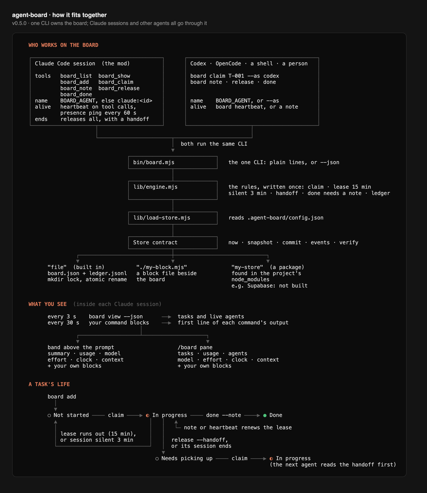
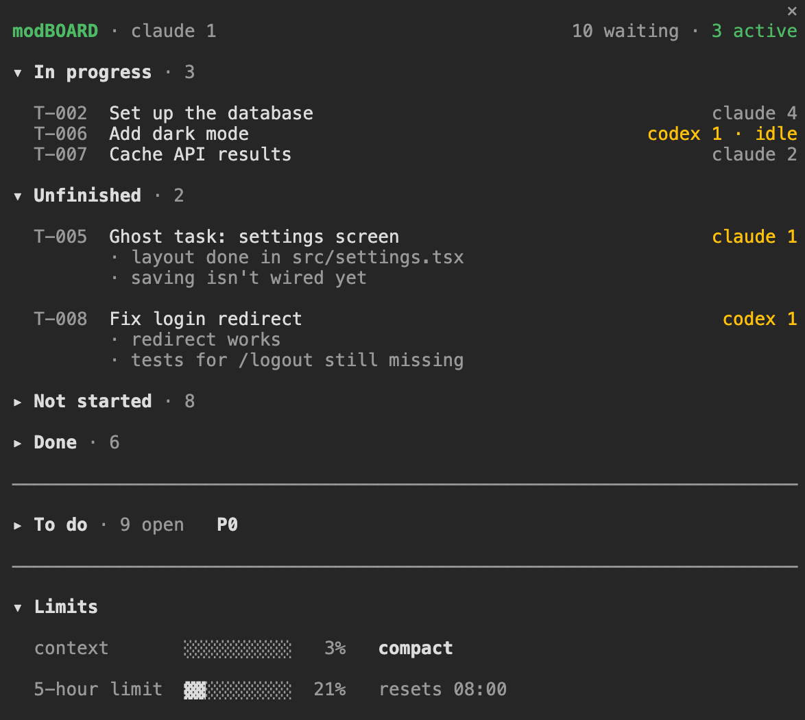

<h1 align="center">
  
</h1>

<p align="center">
  
  
  <a href="https://www.npmjs.com/package/modboard"></a>
  
</p>

<p align="center">
  <b>A task board several coding agents share at once.</b>
</p>

<p align="center">
  Works with <a href="#claude-code">Claude Code</a>,
  <a href="#codex-opencode-or-any-agent-with-a-shell">Codex</a>,
  <a href="#codex-opencode-or-any-agent-with-a-shell">OpenCode</a>, and
  <a href="#codex-opencode-or-any-agent-with-a-shell">anything with a shell</a>, a person included.
</p>

<p align="center">
  <a href="docs/TUTORIAL.md">Tutorial</a> ·
  <a href="#see-it-in-action">Demo</a> ·
  <a href="#install">Install</a> ·
  <a href="#usage">Usage</a> ·
  <a href="#how-it-fits-together">How it works</a> ·
  <a href="#what-you-see">What you see</a>
  <br/>
  <a href="#make-your-own-block">Make your own block</a> ·
  <a href="#what-has-been-tested">Tested</a> ·
  <a href="#project-structure">Structure</a> ·
  <a href="#known-limitations">Limitations</a> ·
  <a href="#contributing">Contributing</a>
</p>

<br/>

Two Claude Code sessions, a Codex session and a person can all claim tasks
from one board, see who holds what, and hand unfinished work to each other
without losing context.

- **One claim wins.** Two agents never end up on the same task.
- **Crashed work comes back.** A task held by a dead agent returns to the board
  on its own.
- **Done means verified.** Nothing is marked done without saying how it was
  checked.

---

## See it in action


Three real Claude Code sessions, recorded live at real speed. Only the wait
before the two workers start is cut.

1. The board names each session as it joins. `claude 1` has `/board` open;
   `claude 2` and `claude 3` are each told to work the board.
2. Both go for T-001. `claude 2` wins, and `claude 3` is refused and takes
   T-002.
3. `claude 2` writes part of T-003, then hands it off. Every band shows
   `T-003` in a yellow box, and the pane lists it under Unfinished with the
   handoff as points.
4. `claude 3` reads the handoff, finishes T-003, and the pane ends on
   `Done · 3`.

What each part of the screen means: [what you see](#what-you-see). The pane
also shows your project's task file under To do; the demo has none, so see
the [screenshots of the pane](#the-board-pane).

---

## Install

> [!TIP]
> New here? The [tutorial](docs/TUTORIAL.md) walks you from install to two
> agents sharing a board, your task.md on it, and every button, in about
> fifteen minutes.

| Agent | How |
|---|---|
| Claude Code | `claude --plugin-dir /path/to/modboard` ([steps](#claude-code)) |
| Codex, OpenCode, a shell | put `board` on your PATH and the protocol in `AGENTS.md` ([steps](#codex-opencode-or-any-agent-with-a-shell)) |
| A person | the same `board` CLI |

### The CLI

Every agent goes through it, Claude Code included.

```bash
git clone https://github.com/Magithar/modboard.git
cd modboard && npm link        # puts `board` on your PATH
```

Or from npm:

```bash
npm install -g modboard          # `board` on your PATH
npm install --save-dev modboard  # inside a project, then `npx board ...`
```

### Claude Code

```bash
claude --plugin-dir /path/to/modboard
```

The session gets the board's tools, a line above the prompt and the `/board`
pane.

The board names the session by what it runs and when it joined: the first is
`claude 1`, the next `claude 2`. The pane's top line says which one it is. To
choose a name instead, start it with `BOARD_AGENT=frontend`.

> [!IMPORTANT]
> **Early access.** The Claude Code mod uses Claude Code's function-hooks API,
> which is early access and can change between releases. It needs Claude Code
> **2.1.295 or newer**. The CLI has no such dependency.

### Codex, OpenCode, or any agent with a shell

Codex needs no name: it marks every shell it runs with its thread, and the
board names each thread by when it joined, `codex 1`, then `codex 2`. Any
other agent gives each session its own name:

```bash
export BOARD_AGENT=opencode
```

Then put this protocol in its instructions (`AGENTS.md`):

> Claim a task before working on it. Note progress. If you stop without
> finishing, release it with a handoff. Never touch a task another agent holds.

---

## Usage

```bash
export BOARD_AGENT=frontend               # your name; Codex and Claude need none

board list                                # ○ todo  ◐ claimed  ● done
board show T-001                          # description, notes, handoffs
board claim T-001                         # exit 6 if another agent holds it
board note T-001 "what changed"           # also renews your lease
board heartbeat                           # renew all your leases
board release T-001 --handoff "done X; left Y; see Z"
board done T-001 --note "ran X, saw Y"    # required: how you verified it
board release-all                         # free everything you hold
board add "title" --desc "..." --accept "how to tell it is done"

board agents                              # live agents
board view                                # every task and live agent, as JSON
board doctor                              # ledger vs state
board taskfile                            # the project's task.md, read only
```

Each command answers in a line or two for a person (`claimed T-001 … it's
yours until 14:05`); `--json` prints the data instead, for scripts. `view` and
`events` are for programs and always print JSON.

| Exit code | Meaning |
|---|---|
| 2 | usage |
| 3 | board busy |
| 4 | no such task |
| 5 | not yours |
| 6 | held by another agent |
| 7 | name in use |

**Claude Code** gets these tools: `board_list`, `board_show`, `board_add`,
`board_claim`, `board_note`, `board_release` and `board_done`. Tool activity
renews the session's leases.

The CLI and the tools keep the board's precise terms (claim, release, handoff,
lease) because agents act on them. The display uses plain words instead, so you
can read it without learning those terms.

---

## How it fits together



One zero-dependency Node CLI owns all state. The Claude Code mod is an adapter
over that CLI. It adds what only Claude Code's host can provide: the session's
identity, a heartbeat on every tool call, and a live pane. Any other agent uses
the same CLI directly.

**Storage is a block.**
The engine never touches files. It reads a snapshot from a Store and commits
conditional writes ("only if this task is still at the version I read"). Any
backend that can do that atomically can hold a board. See
[Make your own block](#a-storage-block-an-adapter).

**Where the board lives.**
`.modboard/` next to the git *common* dir, so every worktree of a repo shares
one board. Set `BOARD_DIR` to override it. Add `.modboard/` to `.gitignore`,
because it is runtime state. A board made before the rename, in
`.agent-board/`, keeps working where it is.

**Claims.**
One lock per board (an atomic `mkdir`). The state file is replaced with an
atomic rename. Exactly one claimant wins, and only the owner can note, release
or finish a task.

**Leases.**
A claim lasts 15 minutes (`BOARD_LEASE_MS`). `heartbeat` or `note` renews it.
An expired claim goes back to todo, and the ledger records it, so an agent that
crashed doesn't hold a task forever.

A Claude session pings the board every minute while it is open, so if one is
killed outright its claims go back after 3 minutes of silence
(`BOARD_PRESENCE_MS`), not 15. An agent that never ran `board register` (a
plain shell) keeps the lease alone.

**Names.**
The board names a session by what it runs and when it joined: `claude 1`,
`claude 2`, `codex 1`. A session keeps its name while it is open; once it ends,
the next new session takes the lowest free number. Codex sends no presence
ping, so its name and claims last as long as its leases.

To choose a name, start a session with `BOARD_AGENT=frontend`. If another live
session already holds it, the new one becomes `frontend-2` and gets a toast
explaining why.

**Handoffs.**
`release --handoff "..."` leaves a note that the next agent reads with `show`
before it continues. When a Claude session ends (exit, `/clear`, resume,
logout), the mod releases everything that session holds, with an automatic
handoff. That matters because a restarted session comes back with a new
identity.

**Done means verified.**
`done` needs a `--note` saying how the task was checked, against its `--accept`
criteria if it has any.

**Ledger.**
Every change is appended to `ledger.jsonl`, including lost claims
(`claim-rejected`, with the holder). `board doctor` checks that the ledger and
the state agree.

---

## What you see

The display shows only what needs you. Everything else waits until you ask.

### The band

One line above the prompt, always visible while there's work on the board:

![The line above the prompt: 2 waiting · 1 active in green, T-005 in a yellow box, Sonnet 5.5, low, and modBOARD in green at the right end beside Claude Code's [-]](docs/band.png)

- **`1 active`** is green: work is moving.
- **`T-005` in a yellow box** (`[T-005]` below) is unfinished: someone stopped
  it partway and left a handoff. Up to three boxes, then `+N`. A box is a
  button: click it to open `/board` at the Unfinished group, and click again
  to fold the group.
- **The model and effort** are buttons too: click one to switch to the next.
- With nothing waiting or in progress, the line disappears.

The 5-hour limit and the context live in the `/board` pane; add `usage` or
`compact` to the band setting to bring them back to the line.

The line never wraps, and stays clear of Claude Code's own `[-]` control at its
right end. In a narrow window its parts shorten first, then the last ones drop
off. The summary keeps its full form longest, and the alert outlasts the
counts:

```
 66 cols   2 waiting · 1 active   [T-005]   Sonnet 5.5   low   modBOARD
 60 cols   2 waiting · 1 active   [T-005]   Sonnet 5.5   modBOARD
 48 cols   2 waiting · 1 active   [T-005]   modBOARD
 36 cols   2 waiting · 1 active   [T-005]
 20 cols   [T-005]
```

The boxes name the one thing that needs you: a task someone stopped partway
that nobody has picked up. A claim gone idle stays off the line, since its
lease frees it on its own; the pane marks it `idle`.

When they're on the line, the 5-hour limit is a bar shown once it passes half,
and the context is a bar of its own; clicking it compacts the conversation, as
`/compact` does. Both are plain with room left, yellow from 70% and red from
90%.

### The `/board` pane

<p align="center">
  
  <br/><em>As it opens</em>
</p>

<table>
  <tr>
    <td width="50%"></td>
    <td width="50%"></td>
  </tr>
  <tr>
    <td align="center">Done and To do opened</td>
    <td align="center">Not started, every priority, Limits folded</td>
  </tr>
</table>

The pane shows what needs you and keeps the rest one click away.

- **Each group's heading is a button** with its count. In progress and
  Unfinished start open, because they need you; Not started starts closed, so
  the whole board fits without scrolling. Opened, a group shows every task in
  it.
- **A row only names who.** The heading says what's happening, so there are
  no marks and no repeated phrases.
- **The bars sit under Limits**, which folds the same way; folded, it keeps
  their figures: `▸ Limits · context 72% · 5-hour 64%`.
- **Colour appears only when something asks for you**: a warning, or a limit
  past 70%.
- If the pane is shorter than the board, its body scrolls with the mouse
  wheel.
- If the board stops answering (the `board` CLI fails), the pane says so at the
  top in red, `board not updating: …`, until it answers again.

### Choosing blocks

The band and the pane are both stacks of display blocks, chosen in the plugin's
settings (`/config`) as comma-separated lists, in order:

| Block | Band | Pane | Shows |
|---|:-:|:-:|---|
| `summary` | ✓ | | what's waiting and active (green), and the one thing left partway (yellow) |
| `board` | ✓ | | `modBOARD` in the logo's green: a button that opens and closes the `/board` pane. It sits at the line's right end, by Claude Code's `[-]`, and on a short line outlasts everything but the summary |
| `tasks` | | ✓ | in progress, unfinished, not started and done, each a heading you click to open or close |
| `taskfile` | | ✓ | the project's `task.md`: how much is open; click it to see what's left, and click its priority to turn it |
| `usage` | ✓ | ✓ | the 5-hour limit as a bar: in the band past 50%, in the pane with its reset. The weekly limit is left out (`/usage` has it) |
| `compact` | ✓ | ✓ | the context window as a bar, and a button that compacts the conversation. Always in the pane; in the band once Claude Code reports the context |
| `model` | ✓ | ✓ | the session's model; click it to switch to the next one |
| `effort` | ✓ | ✓ | the effort level; click it to step to the next one, wrapping from the highest to the lowest |
| `clock` | ✓ | ✓ | the time |
| `context` | ✓ | ✓ | context fill and the session's cost |
| `agents` | | ✓ | who is live on the board |

The defaults:

```
band: summary,model,effort,board
pane: tasks,taskfile,compact,usage
```

### Model and effort

Click the model or the effort to switch: each click runs Claude Code's own
`/model` or `/effort`, the same as typing the command. In the `/board` pane they
also answer to `m` and `e`.

- `/effort` saves the level as your default for new sessions, except `max`,
  which lasts for this session only.
- The `models` setting lists what the model block steps through (default
  `opus,sonnet,haiku`), and `efforts` lists the effort levels (default
  `low,medium,high,xhigh,max`).
- A model or effort changed by hand shows on the next request.
- Until the session's first request, the effort block shows the level it will
  start on: `CLAUDE_CODE_EFFORT_LEVEL` if set, else the model's own
  `effortLevel` under `modelSettings`, else the general `effortLevel` setting.

### task.md

If the checkout has a `task.md`, `tasks.md` or `todo.md` (in any case) at its
root or in `docs/`, the pane shows one quiet line, `To do`, with how much of it
is open. Click it to see what's left, under a dim line naming the file it came
from.

When the file has priorities, a second button turns through them, the way the
effort button turns through levels. Each press steps to the next priority the
file has, then to `all`, then round to the most urgent again, and shows that
tier. It starts on the most urgent:

```
 ▾ To do · 6 open   P0

   from TASKS.md

   · Build local ledger
   · Wire news discovery
   · Fix silent capture
```

`all` shows every open item, most urgent first, each row with its own priority:

```
 ▾ To do · 6 open   all

   from TASKS.md

 P0  Build local ledger
 P0  Wire news discovery
 P0  Fix silent capture
 P1  Supabase sync
 P1  Agent integration
 –   Thumbnail-only mode
```

Priority is read wherever your file keeps it:

- **a heading**: `## P0 — foundation` or `## Sync (P1)`, for everything under it
- **an item**: `- [ ] P2 Benchmarks`, which wins over its heading
- **a table**: a Priority column beside a Task column, one item per row

How the list is built:

- Within a priority the file's own order is kept. Items with none appear under
  `all`, last, marked with a dash. A tier the file doesn't have is skipped.
- Without priorities, the list keeps the file's order under its headings.
- Only what's left is shown, every open item. Checked-off and struck-through
  (`~~old~~`) items, or a table row whose status is done, stay in the file and
  out of the pane. Once a file checks anything off, its plain bullets count as
  notes, not tasks.
- Each click reads the file again, so what you just added is there.

`board taskfile` prints the whole file. The list is there to read: nothing in
it is claimed or added to the board, and the board never writes the file. To
work an item through the board, `board add` it. With no such file, the line
doesn't appear.

### Your own blocks

Show a command's output with no code, or write a block of your own: see
[Make your own block](#make-your-own-block).

---

## Make your own block

modboard is built from blocks, and you can add your own. Pick the row that
matches what you want:

| I want to… | Make | You write |
|---|---|---|
| show a command's output (CI status, git branch…) | [a command block](#a-display-block-from-a-command-no-code) | one line of settings, no code |
| show something from the board, or react to a click | [a display block in code](#a-display-block-in-code) | one `.tsx` file |
| keep the board somewhere else (a database, a server) | [a storage block](#a-storage-block-an-adapter) | one `.mjs` file |


The diagram's source is plain text, [`docs/blocks.txt`](docs/blocks.txt).

### A display block from a command (no code)

The quickest way. Two steps, both in the plugin's settings (`/config`):

**1. Name a command** in the `blocks` setting:

```json
{
  "ci": "gh run list -L1 --json conclusion -q '.[0].conclusion'",
  "branch": "git branch --show-current"
}
```

**2. Add the name** to `band` or `pane`, like a built-in block:

```
band: summary,ci,usage
```

That's it. Every 30 seconds the command runs, and the block shows the first
line it prints, cut to 60 characters. In the band it reads `ci success`, or
just `success` when the line is short.

Good to know:

- Names are lowercase letters, digits and dashes, up to 16 characters, and
  can't reuse a built-in block's name. A bad entry is skipped, with a toast
  saying why.
- A command that fails (non-zero exit) or prints nothing shows nothing.
- The setting lives in your user config, not in the project, so opening
  someone else's repo can never make your session run its commands.

### A display block in code

For a block that reads the board itself, or reacts to a click. Claude Code mods
can't load code at runtime, so this lives in your copy of the mod: fork this
repo (or send a pull request if others would want it).

**1. Write the block** as a file in [`hooks/blocks/`](hooks/blocks/). This one
shows how many tasks are yours:

```tsx
// hooks/blocks/mine.tsx
import { words, type Block } from './types'

export const mine: Block = {
  name: 'mine',

  // In the band: a list of forms, widest first. The band uses the widest
  // that fits, and drops the block when none do. null = show nothing.
  band: ({ ui: { Text }, tasks, who }) => {
    const n = tasks.filter(t => t.claim?.owner === who).length
    if (!n) return null
    return [words(Text, `${n} mine`), words(Text, `${n}`)]
  },

  // In the /board pane: one part of it, or null.
  pane: ({ ui: { Text }, tasks, who }) => (
    <Text>{tasks.filter(t => t.claim?.owner === who).length} tasks are mine</Text>
  ),
}
```

A block can have `band`, `pane`, or both.

**2. Register it** in [`hooks/blocks/index.ts`](hooks/blocks/index.ts):

```ts
import { mine } from './mine'

export const BLOCKS: Block[] = [summary, board, /* … */, mine]
```

**3. Turn it on** by adding `mine` to the `band` or `pane` setting.

**4. Test it** with `claude plugin test .`.

What a block gets (the full shape is in [`types.tsx`](hooks/blocks/types.tsx)):

- the tasks, the live agents, and who this session is
- plan usage and context fill, the model and effort, the time, the width
- your command blocks' output, and the project's task file
- `act`, for what a click can do: switch the model or effort, run `/compact`,
  open the task file or turn its priority

Two rules keep the display calm:

- **Colour only when something needs the person** (theme `warning` and
  `error`).
- **No word or mark that the heading or the order already says.**

For anything that fills up, reuse the bar in `meter.tsx`, as the context and
5-hour limit blocks do.

### A storage block (an adapter)

Only needed when the board should live somewhere other than a local folder,
for example so agents on different machines can share it.

You don't reimplement claims, leases or handoffs: the engine keeps every rule.
Your block just **stores records, each with a version number, and refuses a
write when the version has moved on.**

**1. Write the module.** One file exporting `createStore(config, { dir })`,
which returns five methods (any of them may be async):

| Method | What it does |
|---|---|
| `now()` | the store's clock in ms; leases are timed by it |
| `snapshot()` | every task and agent, each with its version |
| `commit({ writes, events })` | apply all the writes and log the events, or none, and only if each record is still at the version the write expects |
| `events(since)` | the ledger events after `since`, in order |
| `verify()` | does the ledger agree with the state? (`board doctor` shows this) |

`config` is everything in `.modboard/config.json`, so your own settings (a URL,
a table name) go there. `dir` is the `.modboard/` folder.

```js
// my-block.mjs
export function createStore(config, { dir }) {
  return {
    // A database should answer with its own time, so every machine agrees.
    now: () => Date.now(),

    // { tasks:  { 'T-001': { ...task,  version: 3 } },
    //   agents: { frontend: { ...agent, version: 1 } } }
    snapshot: async () => { /* read everything */ },

    // writes: [{ kind: 'task' | 'agent', key, value, expect }]
    //   expect 0 = the record must not exist yet; value null = delete it.
    //   An applied record's version becomes expect + 1.
    // Answer { ok: true }, or { ok: false, conflict: key } and the engine
    // reads again and retries.
    commit: async ({ writes, events }) => { /* one transaction */ },

    // Give each appended event the next `seq` and an `at` time.
    events: async (since = 0) => { /* ... */ },

    verify: async () => ({ ok: true, problems: [] }),
  }
}
```

> [!IMPORTANT]
> `commit` is the only hard part. Checking the versions and writing must be
> **one step**: a database transaction, a conditional write, or a lock. If you
> check, then write, two agents can both pass the check and both hold one task.

Copy from [`examples/store-memory.mjs`](examples/store-memory.mjs), a short,
complete block, or [`lib/store-file.mjs`](lib/store-file.mjs), the built-in
one.

**2. Test it against the contract.** The suite races claims, adds at once,
sends stale writes and reuses names, and fails if your block lets any of them
through:

```js
// my-block.test.mjs, run with: node --test
import { storeContract } from 'modboard/lib/contract.mjs'
import { createStore } from './my-block.mjs'

storeContract('my block', () => createStore({ /* test settings */ }, { dir: '/tmp/board-test' }))
```

Give each `createStore` call a fresh table or folder, so each run starts empty.

**3. Point a board at it** in `.modboard/config.json`. Everything besides
`store` is passed to your block:

| `config.json` | Uses |
|---|---|
| `{ "store": "file" }` | the built-in default |
| `{ "store": "./stores/my-block.mjs", "url": "..." }` | a block file, relative to `.modboard/` |
| `{ "store": "modboard-my-block", "url": "..." }` | a block published as a package |

**4. Check it:** `board add "first task"`, `board view`, `board doctor`. The CLI
refuses a block that won't load or is missing a method, and says which
(exit 2).

**5. Share it (optional).** Publish a package whose entry exports `createStore`
(through `exports` or `main`), with `modboard` as a dev dependency for the
contract tests. Others `npm install modboard-my-block` and name it in
`config.json`. It's found the way Node finds any package: in `node_modules` of
the project that holds the board, or a folder above it.

<details>
<summary><b>Why the version check matters: two agents claim one task</b></summary>

<br/>

Say agents A and B both claim T-001 at the same moment:

1. Both read the board with `snapshot()`. T-001 is at version 3, and nobody
   holds it.
2. Both send `commit`: "claim T-001, only if it is still at version 3".
3. A's commit lands first. The block sees version 3, writes the claim, and
   T-001 moves to version 4.
4. B's commit finds version 4, not 3, so the block writes nothing and answers
   `{ ok: false, conflict: 'T-001' }`.
5. The engine reads again for B, sees that A holds T-001, and refuses B:
   "T-001 is already claimed by A" (exit 6). The ledger records B's attempt as
   `claim-rejected`.

So the engine decides who wins, and the block only keeps the versions honest.
Each commit also appends its ledger events with its writes; if a crash ever
leaves the two out of step, `verify()` says so and `board doctor` reports it.

</details>

---

## What has been tested

These tests ran on 2026-10-12 with two live Claude Code sessions (Sonnet 5.5,
v2.1.296), one shell acting as Codex, and no extra instructions to the agents
beyond the tool descriptions:

| Test | Result |
|---|---|
| Both sessions claim the same task at once | one wins; the other reports the holder and does no work |
| Both told "do the next task on the board" | they collided on one task; the loser moved to another by itself; each claimed before writing files |
| One session does part 1 and releases with a handoff | the other read the handoff and resumed from part 2 without redoing part 1 |
| `codex` claims a task from the shell | Claude was refused, said so, and left it alone |
| An agent's lease runs out | the task returns to todo, and the ledger records `expire` |

### Automated tests

**`npm test`** runs the CLI tests and the store contract:

- a 20-way claim race, ownership, handoff, lease expiry, heartbeat,
  rejected-claim logging, verified done, release-all
- the store contract against the file block and an in-memory reference block
  (concurrent claims and adds, stale writes, names)
- that the CLI loads a block named in `config.json` and refuses a broken one
- that `board taskfile` reads each way a task file keeps items and priorities
  (headings, items, tables, `docs/`) without touching the board

**`claude plugin test .`** runs the mod tests: the pane's sections and alerts
and the eight-row limit, the band and when it stays quiet, names and their
fallback, the tools, the verification note, release on session end, usage and
the context bars, the compact button, the task file's list and its priority
button's whole turn, and choosing blocks.

> [!NOTE]
> The task file, priority and compact features were added after the live tests
> above, and have so far run only under the automated tests.

---

## What modboard is not

- **Not a project manager:** no due dates, assignees or boards per team
- **Not an agent runner:** it never starts, stops or prompts an agent
- **Not a sync service:** one board lives in one place, the storage block
  decides where

modboard is a **claim ledger**: who holds what, what was left for the next
agent, and how each finished task was checked.

---

## Project structure

```
modboard/
├── bin/
│   └── board.mjs            # the one CLI every agent uses
├── lib/
│   ├── engine.mjs           # the rules: claims, leases, handoffs, names, the ledger
│   ├── load-store.mjs       # finds the storage block that config.json names
│   ├── store-file.mjs       # the built-in storage block: a folder
│   ├── taskfile.mjs         # reads a project's task file and its priorities, for display
│   └── contract.mjs         # the tests every storage block must pass
├── examples/
│   └── store-memory.mjs     # a complete storage block in about 20 lines
├── hooks/
│   ├── hooks.json
│   ├── register.tsx         # the Claude Code mod: tools, heartbeat, band, pane
│   └── blocks/              # one file per display block, listed in index.ts;
│                            # meter.tsx is the bar that usage and compact share
├── types/index.d.ts
├── .claude-plugin/
│   ├── plugin.json          # the mod's manifest and settings
│   └── icon.png             # the plugin's icon, the logo's mark
├── test/                    # CLI and store contract tests (npm test)
├── tests/                   # mod tests (claude plugin test .)
├── docs/
│   ├── TUTORIAL.md          # a walk-through from install to two agents
│   ├── system.txt  .png     # how it fits together
│   ├── blocks.txt  .png     # how blocks work
│   ├── band.mjs    .png     # the band image, drawn from the real blocks
│   ├── board-live.gif       # a live recording of three Claude sessions
│   ├── logo.png             # the modBOARD logo
│   ├── pane-*.png           # screenshots of the /board pane
│   └── render.mjs           # rebuilds every image from its .txt
├── CHANGELOG.md             # what changed in each version
├── ROADMAP.md               # what's planned next
└── CONTRIBUTING.md          # how to contribute
```

Each diagram's source is plain text. After editing a `.txt`,
`node docs/render.mjs` rebuilds its page and image.

---

## Known limitations

- **It doesn't work across machines yet.** The storage socket is in place, but
  the only block built is local files. A database or server block comes when a
  real cross-device need does.
- **Usage is per session.** The usage block shows the session's own plan usage,
  which Claude Code reports, not the other agents'.
- **A crash skips the release on session end.** If a Claude process is killed
  outright, its claims are freed once its session has been silent for
  3 minutes. A plain CLI agent that never registered waits out its lease
  (15 minutes).
- **A verification note is the agent's own claim.** The board requires one but
  doesn't run the check itself.
- **The task file is read-only.** The board shows it but never writes it, and
  its items can't be claimed. Add one with `board add` to work it through the
  board.
- **The compact button asks Claude Code to run `/compact`.** Whether a mod's
  request compacts exactly as typing it does is not yet checked in a live
  session.
- **The demo recording predates the quieter pane.** It still shows row marks
  and "is on it".

---

## Contributing

```bash
npm test                    # CLI and store contract tests
claude plugin test .        # the mod's tests
claude plugin validate .    # the mod's manifest and hooks
```

- Changing what the board shows? Run both test suites.
- Adding a storage block or a display block? Start at
  [Make your own block](#make-your-own-block).
- [CONTRIBUTING.md](CONTRIBUTING.md) has the full checklist, where each kind of
  change goes, and the style the project keeps.
- [CHANGELOG.md](CHANGELOG.md) lists what changed in each version, and
  [ROADMAP.md](ROADMAP.md) what's planned next.

---

## License

MIT
