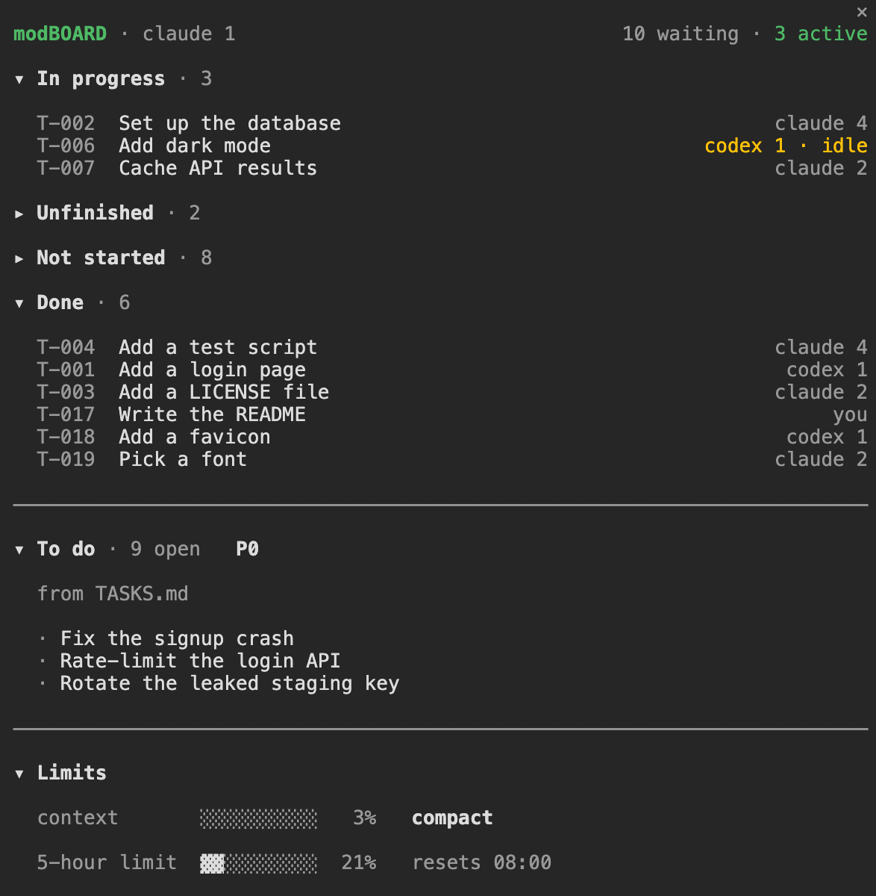
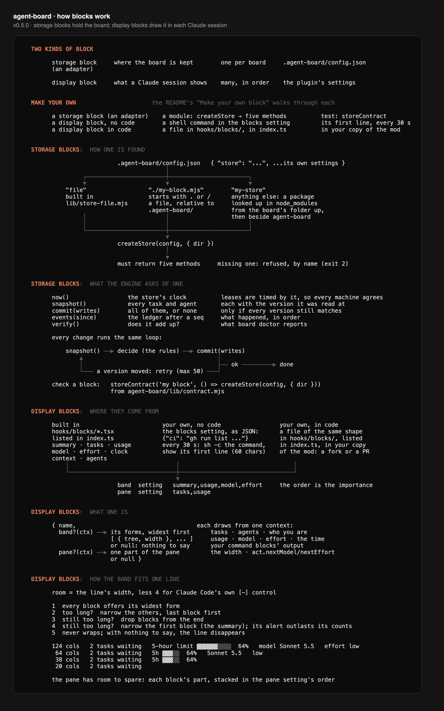

<h1 align="center">
  
</h1>

<p align="center">
  <a href="https://github.com/Magithar/modboard/actions/workflows/ci.yml"></a>
  
  
  <a href="https://www.npmjs.com/package/modboard"></a>
  
</p>

<p align="center">
  <b>One board for every agent and every person. You decide what's on it.</b><br/>
  Works with Claude Code, Codex, OpenCode and anything with a shell.
</p>

<p align="center">
  <a href="#see-it-in-action">Demo</a> ·
  <a href="#quick-start">Quick start</a> ·
  <a href="#everyday-use">Everyday use</a> ·
  <a href="#what-you-see">What you see</a> ·
  <a href="#settings">Settings</a> ·
  <a href="#how-it-works">How it works</a> ·
  <a href="#make-your-own-block">Make your own block</a> ·
  <a href="docs/TUTORIAL.md">Tutorial</a>
</p>

<br/>

## What it does

modBOARD puts one board in your repo that every agent and every person
shares. Claude Code, Codex, OpenCode, a shell script and you all read the same
board and write to it the same way. You decide what's on it: the work in
progress, your task.md, CI status, the git branch, or any command's output.

- **Running several agents at once?** They stop tripping over each other. Each
  one claims its work, so no two do the same job, and work an agent drops
  comes back with a note on where it stopped.
- **Switching between agents?** The board doesn't belong to any of them. Start
  a task in Claude Code, finish it in Codex, and check it yourself from the
  shell.
- **Want your project at a glance?** Put the things you keep checking on the
  board. Name a command and its output shows up beside the work, with no code.

| | |
|---|---|
| **You decide what's on it** | The board is built from blocks: tasks, your task.md, the model and effort, usage, or your own from any command's output. [How](#make-your-own-block) |
| **Every agent, the same way** | One CLI that anything with a shell can run. Claude Code also gets a line above the prompt and the `/board` pane. |
| **One claim wins** | Two agents never end up on the same task. |
| **Crashed work comes back** | A task held by an agent that died returns to the board on its own. |
| **Handoffs keep context** | An agent that stops partway leaves a note, with the worktree it was in and the last check that passed; the next one reads it and carries on there. |
| **Done means verified** | Nothing is marked done without saying how it was checked. |
| **Keep it where you want** | The board lives in a folder by default. A storage block you write can keep it in a database instead. |

---

## See it in action


Three real Claude Code sessions, recorded live at real speed. Only the wait
before the two workers start is cut. The board shows its default blocks; you
can [change them](#settings).

1. The board names each session as it joins. `claude 1` has `/board` open;
   `claude 2` and `claude 3` are each told to work the board.
2. Both go for T-001. `claude 2` wins, and `claude 3` is refused and takes
   T-002.
3. `claude 2` writes part of T-003, then hands it off. The line above every
   prompt (the band) shows `T-003` in a yellow box, and the pane lists it under Unfinished with the
   handoff as points.
4. `claude 3` reads the handoff, finishes T-003, and the pane ends on
   `Done · 3`.

The demo project has no task file, so **To do** doesn't appear here; see
[Your task.md](#your-taskmd).

---

## Quick start

> [!TIP]
> New here? The [tutorial](docs/TUTORIAL.md) walks you from install to two
> agents sharing a board, your task.md on it, and every button, in about
> fifteen minutes.

**1. Install the `board` CLI.** Every agent uses it, Claude Code included.

```bash
npm install -g modboard
```

Or from source: clone `https://github.com/Magithar/modboard.git` and run
`npm link` inside it. To use it in one project only, run
`npm install --save-dev modboard` there, then `npx board …`.

**2. Connect your agents.**

| Agent | What to do | Its name on the board |
|---|---|---|
| **Claude Code** | `claude --plugin-dir /path/to/modboard` | `claude 1`, `claude 2`, … |
| **Codex** | put the protocol below in `AGENTS.md` | `codex 1`, `codex 2`, … |
| **OpenCode, a shell** | `export BOARD_AGENT=opencode`, and put the protocol in `AGENTS.md` | the name you set |
| **A person** | use the same `board` commands | the name you set |

The protocol, for any agent's instructions:

> Claim a task before working on it. Note progress. Record checks that pass
> (`board check`). If you stop without finishing, release it with a handoff.
> Never touch a task another agent holds.

Claude Code gets the board's tools, a line above the prompt and the `/board`
pane. Names are automatic: the board numbers sessions as they join. To pick
one yourself, start Claude Code with `BOARD_AGENT=frontend`.

> [!IMPORTANT]
> **Early access.** The Claude Code mod uses Claude Code's function-hooks API,
> which is early access and can change between releases. It needs Claude Code
> **2.1.295 or newer**. The CLI has no such dependency.

**3. Add a task and open the board.**

```bash
board add "Add a login page" --accept "signing in works"
```

Then type `/board` in Claude Code.

**4. Choose what's on it (optional).** Open `/config` and list the blocks you
want in `band` and `pane`, or name a command to make your own. See
[Settings](#settings) and [Make your own block](#make-your-own-block).

---

## Everyday use

```bash
board list                                # ○ todo  ◐ claimed  ● done
board show T-001                          # description, notes, handoffs
board claim T-001                         # exit 6 if another agent holds it
board note T-001 "what changed"           # also renews your claim
board check T-001 "npm test"              # runs it; records it only if it passes
board release T-001 --handoff "done X; left Y; see Z"
board done T-001 --note "ran X, saw Y"    # required: how you checked it
board add "title" --desc "..." --accept "how to tell it is done"
board add "Ship release" --ring           # ring the alarm when it's done
```

Each command answers in a line or two (`claimed T-001 … it's yours until
14:05`). Add `--json` for the data instead.

A handoff and a check record the worktree, branch and commit they were made
in, and whether anything was uncommitted, so the next agent knows where the
work is and what last passed there. `board check --passed` records a check you
already ran yourself, without running it again.

<details>
<summary><b>More commands, exit codes and the Claude Code tools</b></summary>

<br/>

```bash
board heartbeat                           # renew all your claims
board release-all                         # free everything you hold
board whoami                              # the name the board gave you
board agents                              # who is live
board view                                # every task and live agent, as JSON
board doctor                              # check the ledger against the state
board taskfile                            # the project's task.md, read only
board ring T-001                          # ring the alarm when it's done; --off takes it back
```

| Exit code | Meaning |
|---|---|
| 2 | usage, or a flag the command doesn't take (the error names the ones it does) |
| 3 | board busy |
| 4 | no such task |
| 5 | not yours |
| 6 | held by another agent |
| 7 | name in use |
| 8 | the check failed; nothing was recorded |

**Claude Code** gets these tools: `board_list`, `board_show`, `board_add`,
`board_claim`, `board_note`, `board_check`, `board_release`, `board_done`
`board_alarm` and `board_location`. Any tool call renews the session's claims.

The CLI and the tools use the board's precise terms (claim, release, handoff,
lease), because agents act on them. The display uses plain words, so you can
read it without learning those terms.

</details>

---

## What you see

Claude Code shows the board in two places: the band, one line above the
prompt, and the `/board` pane. Both are lists of blocks you choose in
[Settings](#settings). With the default blocks, the display shows only what
needs you, and everything else waits until you ask.

### The band

One line above the prompt, while there's work on the board:

![The line above the prompt: 2 waiting · 1 active in green, T-005 in a yellow box, Sonnet 5.5, low, and modBOARD in green at the right end beside Claude Code's [-]](docs/band.png)

| Part | What it means | Click it to |
|---|---|---|
| `2 waiting · 1 active` | tasks not started, and tasks being worked on (in green) | |
| `T-005` in a yellow box | someone stopped it partway and left a handoff; up to three boxes, then `+N` | open `/board` at Unfinished; click again to fold it |
| `Sonnet 5.5` · `low` | the model and effort | switch to the next one |
| `modBOARD` | the board | open or close `/board` |

With nothing waiting or in progress, the line disappears. It never wraps: in a
narrow window the last parts drop off first.

<details>
<summary><b>How the band fits a narrow window</b></summary>

<br/>

```
 66 cols   2 waiting · 1 active   [T-005]   Sonnet 5.5   low   modBOARD
 60 cols   2 waiting · 1 active   [T-005]   Sonnet 5.5   modBOARD
 48 cols   2 waiting · 1 active   [T-005]   modBOARD
 36 cols   2 waiting · 1 active   [T-005]
 20 cols   [T-005]
```

The boxes outlast the counts, because they're the one thing that needs you. A
claim gone idle stays off the line, since its lease frees it on its own; the
pane marks it `idle`. The line stays clear of Claude Code's own `[-]` at its
right end.

</details>

### The `/board` pane

<p align="center">
  
  <br/><em>As it opens</em>
</p>

<table>
  <tr>
    <td width="50%"></td>
    <td width="50%"></td>
  </tr>
  <tr>
    <td align="center">Done and To do opened</td>
    <td align="center">Not started, every priority, Limits folded</td>
  </tr>
</table>

| Section | What it shows |
|---|---|
| **In progress** | who is on what. `codex 1 · idle` in yellow: no note or heartbeat for most of its claim's time |
| **Unfinished** | work stopped partway: the handoff as points, then `where` (branch and commit), `path` (the worktree; press it to put a `cd` to it on the clipboard) and `check` (the last check that passed) |
| **Not started** | everything waiting |
| **Done** | what's finished, and who finished it |
| **To do** | what's left in [your task.md](#your-taskmd) |
| **Limits** | the context window (with a `compact` button) and the 5-hour limit |

- **Every heading is a button.** Click to open or close it. In progress and
  Unfinished start open, because they need you.
- **Colour only when something needs you**: yellow for unfinished or idle work
  and for a limit past 70%; red for a limit past 90%.
- If the board stops answering, a red `board not updating: …` line says so at
  the top until it answers again.

### Your task.md

If your project has a `task.md`, `tasks.md` or `todo.md` (upper or lower case) at its
root or in `docs/`, the pane shows what's left in it under **To do**.

<table>
  <tr>
    <td valign="top"></td>
    <td valign="top"></td>
  </tr>
  <tr>
    <td align="center"><code>P0</code>: the most urgent tier</td>
    <td align="center"><code>all</code>: every item, by priority</td>
  </tr>
</table>

- **Click `To do`** to open it. Each click reads the file again.
- **Click the priority** (`P0`) to step through the tiers the file has, then
  `all`, then round again.
- **Priorities** are read from a heading (`## P0 — launch`, `## Sync (P1)`),
  an item (`- [ ] P2 Benchmarks`, which wins over its heading), or a table with
  a Priority column.
- **Only what's left shows.** Checked-off items, struck-through items
  (`~~old~~`) and done table rows stay out of the list.
- **It's read-only.** The board never writes the file, and its items can't be
  claimed. To work one through the board, `board add` it.

<details>
<summary><b>More on how the list is built</b></summary>

<br/>

- Within a priority, the file's own order is kept. Items with no priority come
  last under `all`, marked with a dash. A tier the file doesn't have is
  skipped.
- Without any priorities, the list keeps the file's order under its headings,
  and there's no priority button.
- A table row counts as done when its Status says done, complete or ✅.
- Once a file checks anything off, its plain bullets count as notes, not
  tasks.
- `board taskfile` prints the whole list; `--json` gives it as data.

</details>

---

## Settings

Open the plugin's settings with `/config`.

### What shows where

The band and the pane are each a list of display blocks, in order:

```
band: summary,model,effort,board        (the default)
pane: work,todo,compact,usage           (the default)
```

| Block | Band | Pane | Shows |
|---|:-:|:-:|---|
| `summary` | ✓ | | what's waiting and active, and the unfinished boxes |
| `board` | ✓ | | the `blocks` and `modBOARD` buttons |
| `work` | | ✓ | who's doing what: In progress, Unfinished, Not started and Done |
| `todo` | | ✓ | your task.md under To do |
| `compact` | ✓ | ✓ | the context window as a bar, and a button that compacts the conversation |
| `usage` | ✓ | ✓ | the 5-hour limit as a bar (in the band, only once it passes 50%) |
| `model` | ✓ | ✓ | the model; click to switch |
| `effort` | ✓ | ✓ | the effort level; click to step through |
| `clock` | ✓ | ✓ | the time |
| `pixel-clock` | ✓ | ✓ | the time in large pixel digits, the weather beside it, and the alarm |
| `weather` | ✓ | | the temperature and conditions: `☀ 18°` |
| `context` | ✓ | ✓ | context fill and the session's cost, as text |
| `agents` | | ✓ | who is live on the board |

`work` and `todo` were called `tasks` and `taskfile` before 0.6.3; the old
names still work.

Or click **blocks** on the band: the pane turns to a list of the blocks it
can show, on two tabs. On **Blocks**, a click ticks one on or off. On
**Order**, the ticked blocks are numbered in the board's order, and **▲**
and **▼** move one a place (grey where there's no room to move). Beside the tabs, in yellow, is what
**Done** will change: `added agents · order changed`. **Done** shows the board. The
choice is kept between sessions, until `pane` is changed in `/config`.

In a narrow window, the band's last blocks drop first, so put what matters
most first. To show something not in this list, [make your own
block](#make-your-own-block).

### Pixel clock, weather and alarm

Tick `pixel-clock` on the list of blocks, or name it in `pane`:

```
  █▀█ █▀█   ▀▀█ ▀▀█      ☀ 18°  Bengaluru
  █ █ ▀▀█ ▀  ▀█ █▀▀      clear · H 24°
  █▄█ ▄▄█ ▀ ▄▄█ █▄▄      ⏰ 07:30
```

In the band it shows the time plainly, and the next alarm: `09:41  ⏰ 07:30`.

| Setting | Default | What it is |
|---|---|---|
| `location` | empty | a city (`Bengaluru`) or `latitude,longitude` for the weather; empty, modboard asks |
| `units` | `celsius` | `celsius` or `fahrenheit` |
| `alarm` | empty | times to ring at, comma-separated: `07:30, 6:45pm` |

- **Where you are**: tick `pixel-clock` and press **Done**, and modboard asks
  once: *Use my location (from my IP)*, *Not now*, or type your city under
  **Other**. Esc or *Not now* means no weather, and it doesn't ask again; the
  clock says `weather: /board location` instead. Later, type
  `/board location`, or ask Claude to add a location for the weather (it calls
  `board_location`), and it asks again. Your answer is kept between sessions;
  `location` in `/config`, when set, wins over it. *Use my location* sends
  your IP to [ipapi.co](https://ipapi.co) once, for its city, and keeps that.
- **Weather** comes from [Open-Meteo](https://open-meteo.com), which needs no
  key, through Claude Code's own fetch, so it follows your organization's
  network policy. Nothing is sent until there's a location, and only that
  location is sent. It's read every 20 minutes; offline, the last reading
  stays and says how old it is.
- **The alarm** rings at its minute: a toast, a notification, a chime for up
  to a minute, and the clock turns yellow with a **stop** button. From the
  prompt: `/board alarm 7:30` adds one, `/board alarm` lists them,
  `/board alarm off 7:30` removes one and `/board alarm off` clears all. Those
  are kept between sessions, until `alarm` is changed in `/config`. It rings
  only while a session is open.
- **When something important is done.** Add a task with `--ring`
  (`board add "Ship release" --ring`, or `board ring T-004` later): when it
  turns done, whoever finished it (Claude, Codex or a person), the alarm
  chimes three times and the clock shows `⏰ T-004 done · Ship release`.
  Tasks already done when the session starts stay quiet.
- **Agents can ring it too**, with the `board_alarm` tool and a note saying
  why: now (`⏰ deploy is green`), or once at a time or in some minutes
  (`⏰ 18:00 · check the deploy`; a bare `1:30` means whichever 1:30 comes
  next), which `/board alarm` lists and
  `/board alarm off` clears. Its description tells them to ring only when you
  asked or something needs you, and it rings now at most once a minute.

### Model and effort

Clicking the model or effort runs Claude Code's own `/model` or `/effort`, the
same as typing it. In the pane, the keys `m` and `e` do the same.

| Setting | Default | What it is |
|---|---|---|
| `models` | `opus,sonnet,haiku` | what the model button steps through |
| `efforts` | `low,medium,high,xhigh,max` | what the effort button steps through |

`/effort` saves the level as your default for new sessions, except `max`,
which lasts for this session only. Before the first request, the effort block shows
the level the session will start on: `CLAUDE_CODE_EFFORT_LEVEL` if set, else
the model's own `effortLevel` under `modelSettings`, else the general
`effortLevel`.

### Environment

| Variable | Default | What it does |
|---|---|---|
| `BOARD_AGENT` | a number, given by the board | the name to use on the board |
| `BOARD_DIR` | `.modboard/`, beside the repo's git folder | where the board lives |
| `BOARD_LEASE_MS` | 15 minutes | how long a claim lasts without a note or heartbeat |
| `BOARD_PRESENCE_MS` | 3 minutes | how long a Claude session can be silent before its claims go back |

---

## How it works


One small Node CLI, `board`, owns the board; it has no dependencies. The Claude
Code mod sits on top of it and adds what only Claude Code can provide: the session's
name, a heartbeat on every tool call, and the display. Every other agent uses
the CLI directly.

| | How it works |
|---|---|
| **Where the board lives** | `.modboard/`, beside the repo's git folder, so every worktree shares one board. Add it to `.gitignore`. |
| **One claim wins** | Each change takes a lock and replaces the board in one step, so exactly one claimant wins. Only the holder can note, release or finish a task. |
| **Claims expire** | A claim lasts 15 minutes; a note or heartbeat renews it. An expired claim goes back to waiting. If its agent had recorded work (a note or a check), the board writes a handoff for it, so the task shows under Unfinished with the last place the work was seen, marked *last known, may be stale*. |
| **Crashes recover fast** | An open Claude session pings the board every minute. If it's killed, its claims go back after 3 minutes of silence. |
| **Names** | The board numbers sessions as they join: `claude 1`, `codex 1`. A session keeps its name while it's open; a new one takes the lowest free number. |
| **Handoffs** | `release --handoff` leaves a note the next agent reads first, with the worktree, branch and commit the work is in. A Claude session that ends releases what it holds, with a handoff of its own. |
| **Checks** | `board check` runs a command in your checkout and records it only if it passes, with the commit it ran at; the next agent sees the last check that passed. `--passed` (and the `board_check` tool) records one an agent ran itself, marked as reported. |
| **Done means verified** | `done` needs a `--note` on how the task was checked, against its `--accept` criteria if it has any. |
| **A ledger** | Every change, lost claims included, is appended to `ledger.jsonl`. `board doctor` checks it against the board. |

<details>
<summary><b>More detail</b></summary>

<br/>

- **Storage is a block.** The engine never touches files itself. It reads a
  snapshot from a store and commits conditional writes ("only if this task is
  still at the version I read"). Any backend that can do that in one step can
  hold a board: see [a storage block](#a-storage-block-an-adapter).
- **The lock** is an atomic `mkdir`, and the board file is replaced with an
  atomic rename.
- **Names you choose:** if another live session already holds the name you
  ask for, the new one becomes `frontend-2` and a toast says why.
- **Codex** sends no presence ping, so its name and claims last only as long
  as its leases. An agent that never registered (a plain shell) is the same.
- **A board made before the rename**, in `.agent-board/`, keeps working where
  it is.

</details>

### What modBOARD is not

- **Not a project manager:** no due dates, assignees or per-team boards.
- **Not an agent runner:** it never starts, stops or prompts an agent.
- **Not a sync service:** one board lives in one place; the storage block
  decides where.

At its core is a **claim ledger**: who holds what, what was left for the next
agent, and how each finished task was checked. Everything else on the board is
a block you choose.

---

## Make your own block

modBOARD is built from blocks, and you can add your own. Pick the row that
matches what you want:

| I want to… | Make | You write |
|---|---|---|
| show a command's output (CI status, git branch…) | [a command block](#a-display-block-from-a-command-no-code) | two settings, no code |
| show something from the board, or react to a click | [a display block in code](#a-display-block-in-code) | one `.tsx` file |
| keep the board somewhere else (a database, a server) | [a storage block](#a-storage-block-an-adapter) | one `.mjs` file |



The diagram's source is plain text, [`docs/blocks.txt`](docs/blocks.txt).

### A display block from a command (no code)

The quickest way. Two steps, both in the plugin's settings (`/config`):

**1. Name a command** in the `blocks` setting:

```json
{
  "ci": "gh run list -L1 --json conclusion -q '.[0].conclusion'",
  "branch": "git branch --show-current"
}
```

**2. Add the name** to `band` or `pane`, like a built-in block:

```
band: summary,ci,model,effort,board
```

That's it. Every 30 seconds the command runs, and the block shows the first
line it prints, cut to 60 characters. In the band it reads `ci success`, or
just `success` when the line is short.

Good to know:

- Names are lowercase letters, digits and dashes, up to 16 characters, and
  can't reuse a built-in block's name. A bad entry is skipped, with a toast
  saying why.
- A command that fails (non-zero exit) or prints nothing shows nothing.
- The setting lives in your user config, not in the project, so opening
  someone else's repo can never make your session run its commands.

### A display block in code

For a block that reads the board itself, or reacts to a click. Claude Code mods
can't load code at runtime, so this lives in your copy of the mod: fork this
repo (or send a pull request if others would want it).

**1. Write the block** as a file in [`hooks/blocks/`](hooks/blocks/). This one
shows how many tasks are yours:

```tsx
// hooks/blocks/mine.tsx
import { words, type Block } from './types'

export const mine: Block = {
  name: 'mine',

  // In the band: a list of forms, widest first. The band uses the widest
  // that fits, and drops the block when none do. null = show nothing.
  band: ({ ui: { Text }, tasks, who }) => {
    const n = tasks.filter(t => t.claim?.owner === who).length
    if (!n) return null
    return [words(Text, `${n} mine`), words(Text, `${n}`)]
  },

  // In the /board pane: one part of it, or null.
  pane: ({ ui: { Text }, tasks, who }) => (
    <Text>{tasks.filter(t => t.claim?.owner === who).length} tasks are mine</Text>
  ),
}
```

A block can have `band`, `pane`, or both.

**2. Register it** in [`hooks/blocks/index.ts`](hooks/blocks/index.ts):

```ts
import { mine } from './mine'

export const BLOCKS: Block[] = [summary, board, /* … */, mine]
```

**3. Turn it on** by adding `mine` to the `band` or `pane` setting.

**4. Test it** with `claude plugin test .`.

What a block gets (the full shape is in [`types.tsx`](hooks/blocks/types.tsx)):

- the tasks, the live agents, and who this session is
- plan usage and context fill, the model and effort, the time, the width
- your command blocks' output, and the project's task file
- `act`, for what a click can do: switch the model or effort, run `/compact`,
  open a group, the task file or the pane

Two rules keep the display calm:

- **Colour only when something needs you** (theme `warning` and `error`).
- **No word or mark that the heading or the order already says.**

For anything that fills up, reuse the bar in `meter.tsx`, as the context and
5-hour limit blocks do.

### A storage block (an adapter)

Only needed when the board should live somewhere other than a local folder,
for example so agents on different machines can share it.

You don't reimplement claims, leases or handoffs: the engine keeps every rule.
Your block just **stores records, each with a version number, and refuses a
write when the version has moved on.**

**1. Write the module.** One file exporting `createStore(config, { dir })`,
which returns five methods (any of them may be async):

| Method | What it does |
|---|---|
| `now()` | the store's clock in ms; leases are timed by it |
| `snapshot()` | every task and agent, each with its version |
| `commit({ writes, events })` | apply all the writes and log the events, or none, and only if each record is still at the version the write expects |
| `events(since)` | the ledger events after `since`, in order |
| `verify()` | does the ledger agree with the state? (`board doctor` shows this) |

`config` is everything in `.modboard/config.json`, so your own settings (a URL,
a table name) go there. `dir` is the `.modboard/` folder.

```js
// my-block.mjs
export function createStore(config, { dir }) {
  return {
    // A database should answer with its own time, so every machine agrees.
    now: () => Date.now(),

    // { tasks:  { 'T-001': { ...task,  version: 3 } },
    //   agents: { 'claude 1': { ...agent, version: 1 } } }
    snapshot: async () => { /* read everything */ },

    // writes: [{ kind: 'task' | 'agent', key, value, expect }]
    //   expect 0 = the record must not exist yet; value null = delete it.
    //   An applied record's version becomes expect + 1.
    // Answer { ok: true }, or { ok: false, conflict: key } and the engine
    // reads again and retries.
    commit: async ({ writes, events }) => { /* one transaction */ },

    // Give each appended event the next `seq` and an `at` time.
    events: async (since = 0) => { /* ... */ },

    verify: async () => ({ ok: true, problems: [] }),
  }
}
```

> [!IMPORTANT]
> `commit` is the only hard part. Checking the versions and writing must be
> **one step**: a database transaction, a conditional write, or a lock. If you
> check, then write, two agents can both pass the check and both hold one task.

Copy from [`examples/store-memory.mjs`](examples/store-memory.mjs), a short,
complete block, or [`lib/store-file.mjs`](lib/store-file.mjs), the built-in
one.

**2. Test it against the contract.** The suite races claims, adds tasks at
once, sends stale writes and reuses names, and fails if your block lets any of them
through:

```js
// my-block.test.mjs, run with: node --test
import { storeContract } from 'modboard/lib/contract.mjs'
import { createStore } from './my-block.mjs'

storeContract('my block', () => createStore({ /* test settings */ }, { dir: '/tmp/board-test' }))
```

Give each `createStore` call a fresh table or folder, so each run starts empty.

**3. Point a board at it** in `.modboard/config.json`. Everything besides
`store` is passed to your block:

| `config.json` | Uses |
|---|---|
| `{ "store": "file" }` | the built-in default |
| `{ "store": "./stores/my-block.mjs", "url": "..." }` | a block file, relative to `.modboard/` |
| `{ "store": "modboard-my-block", "url": "..." }` | a block published as a package |

**4. Check it:** `board add "first task"`, `board view`, `board doctor`. The CLI
refuses a block that won't load or is missing a method, and says which
(exit 2).

**5. Share it (optional).** Publish a package whose entry exports `createStore`
(through `exports` or `main`), with `modboard` as a dev dependency for the
contract tests. Others `npm install modboard-my-block` and name it in
`config.json`. It's found the way Node finds any package: in `node_modules` of
the project that holds the board, or a folder above it.

<details>
<summary><b>Why the version check matters: two agents claim one task</b></summary>

<br/>

Say agents A and B both claim T-001 at the same moment:

1. Both read the board with `snapshot()`. T-001 is at version 3, and nobody
   holds it.
2. Both send `commit`: "claim T-001, only if it is still at version 3".
3. A's commit lands first. The block sees version 3, writes the claim, and
   T-001 moves to version 4.
4. B's commit finds version 4, not 3, so the block writes nothing and answers
   `{ ok: false, conflict: 'T-001' }`.
5. The engine reads again for B, sees that A holds T-001, and refuses B:
   "T-001 is already claimed by A" (exit 6). The ledger records B's attempt as
   `claim-rejected`.

So the engine decides who wins, and the block only keeps the versions honest.
Each commit also appends its ledger events with its writes; if a crash ever
leaves the two out of step, `verify()` says so and `board doctor` reports it.

</details>

---

## Testing

<details>
<summary><b>Tested live with two Claude Code sessions and a shell</b></summary>

<br/>

These ran on 2026-10-12 with two live Claude Code sessions (Sonnet 5.5,
v2.1.296), one shell acting as Codex, and no instructions to the agents beyond
the tool descriptions:

| Test | Result |
|---|---|
| Both sessions claim the same task at once | one wins; the other reports the holder and does no work |
| Both told "do the next task on the board" | they collided on one task; the loser moved to another by itself; each claimed before writing files |
| One session does part 1 and releases with a handoff | the other read the handoff and resumed from part 2 without redoing part 1 |
| `codex` claims a task from the shell | Claude was refused, said so, and left it alone |
| An agent's lease runs out | the task goes back to waiting, and the ledger records `expire`; with work recorded, it waits under Unfinished, with a handoff the board wrote |

The task file, priorities, compact button and automatic names came later.
They've run in live sessions while being built (the demo above shows the
automatic names), but haven't been through this full set.

</details>

<details>
<summary><b>Tested live with Codex</b></summary>

<br/>

This ran on 2026-11-20 with Codex CLI 0.155.1 in its default
`workspace-write` sandbox, an `AGENTS.md` holding only the protocol above,
and a board of two tasks, one already held by `alice`. Codex was told only
"Do every task on the board that you can."

| Test | Result |
|---|---|
| Learning the CLI | ran `board` for its usage, then `board list` |
| Its name | `board whoami` answered `codex 1`, from `CODEX_THREAD_ID`, with nothing set |
| Claim before work | claimed the open task, then wrote the file |
| Done means verified | its first `done` without `--note` was refused; it checked the file and finished with a note |
| A task another agent holds | "claimed by alice, so I left it untouched" |
| The sandbox | wrote `.modboard/` without trouble |
| The ledger | `board doctor`: the ledger and the state agree |

</details>

<details>
<summary><b>Automated tests</b></summary>

<br/>

**`npm test`** runs the CLI tests and the store contract:

- a 20-way claim race, ownership, handoffs and the worktree they record,
  checks (recorded only when they pass), lease expiry, heartbeats,
  rejected-claim logging, verified done, release-all, automatic names,
  refused flags
- the store contract against the file block and an in-memory block
  (concurrent claims and adds, stale writes, names)
- that the CLI loads a block named in `config.json` and refuses a broken one
- that `board taskfile` reads each way a task file keeps items and priorities

**`claude plugin test .`** runs the mod's tests: the band and how it fits a
line, the pane's groups and what folds, handoff points and the where, path
and check rows under them (and copying the path), the task file and its
priority button, the Limits heading, the error line, names, the tools, release
on session end, and choosing blocks.

**CI** runs both on every push to `main` and every pull request: `npm test`
on Node 18, 20 and 22, and the mod's tests and `claude plugin validate .`
with the latest Claude Code.

</details>

### Known limitations

- **One machine for now.** The storage socket is in place, but the only block
  built keeps the board in local files.
- **Usage is per session.** The usage bar shows this session's own plan usage,
  not the other agents'.
- **A killed CLI agent's claims wait out their lease.** A killed Claude session frees its
  claims after 3 minutes of silence; a plain CLI agent that never registered
  waits out the full 15.
- **A verification note is the agent's word.** The board requires one but
  doesn't run the check itself.
- **The task file is read-only.** Add an item with `board add` to work it
  through the board.

---

## Contributing

```bash
npm test                    # CLI and store contract tests
claude plugin test .        # the mod's tests
claude plugin validate .    # the mod's manifest and hooks
```

[CONTRIBUTING.md](CONTRIBUTING.md) has the checklist, where each kind of change
goes, and the style the project keeps. [CHANGELOG.md](CHANGELOG.md) lists what
changed in each version, and [ROADMAP.md](ROADMAP.md) what's planned next.

<details>
<summary><b>Project structure</b></summary>

<br/>

```
modboard/
├── bin/board.mjs            # the one CLI every agent uses
├── lib/
│   ├── engine.mjs           # the rules: claims, leases, handoffs, checks, names, the ledger
│   ├── load-store.mjs       # finds the storage block that config.json names
│   ├── store-file.mjs       # the built-in storage block: a folder
│   ├── taskfile.mjs         # reads a project's task file and its priorities
│   └── contract.mjs         # the tests every storage block must pass
├── examples/
│   └── store-memory.mjs     # a complete storage block in about 20 lines
├── hooks/
│   ├── register.tsx         # the Claude Code mod: tools, heartbeat, band, pane
│   └── blocks/              # one file per display block, listed in index.ts
├── .claude-plugin/
│   └── plugin.json          # the mod's manifest and settings
├── test/                    # CLI and store contract tests (npm test)
├── tests/                   # mod tests (claude plugin test .)
├── CHANGELOG.md             # what changed in each version
├── ROADMAP.md               # what's planned next
├── CONTRIBUTING.md          # how to contribute
└── docs/
    ├── TUTORIAL.md          # from install to two agents sharing a board
    ├── system.txt  .png     # how it fits together
    ├── blocks.txt  .png     # how blocks work
    ├── render.mjs           # rebuilds each diagram from its .txt
    ├── band.mjs    .png     # the band image
    ├── board-live.gif       # the live demo
    ├── pane-*.png           # screenshots of the /board pane
    ├── taskfile-*.png       # the To do list, at P0 and at all
    └── logo.png             # the modBOARD logo
```

</details>

---

## License

MIT
