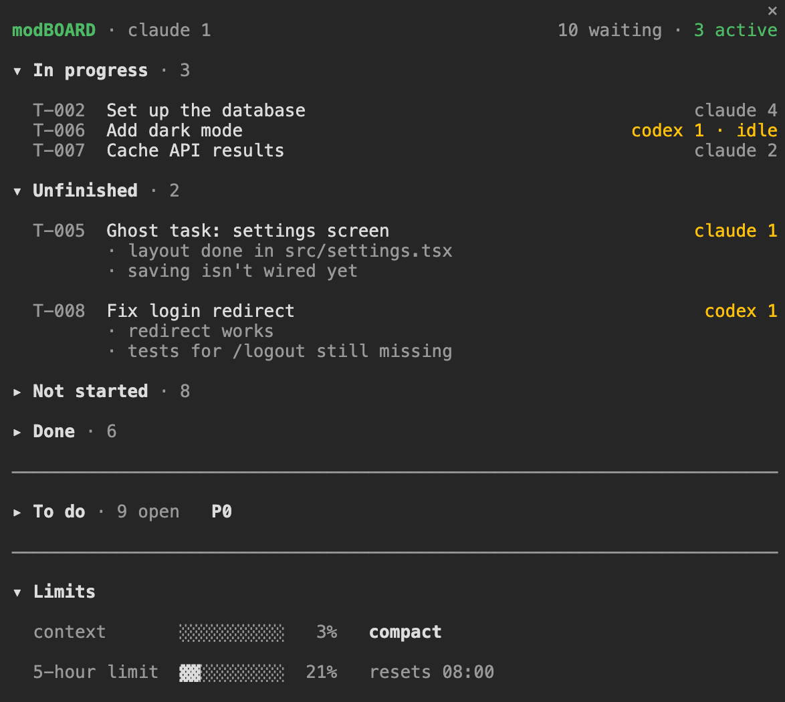
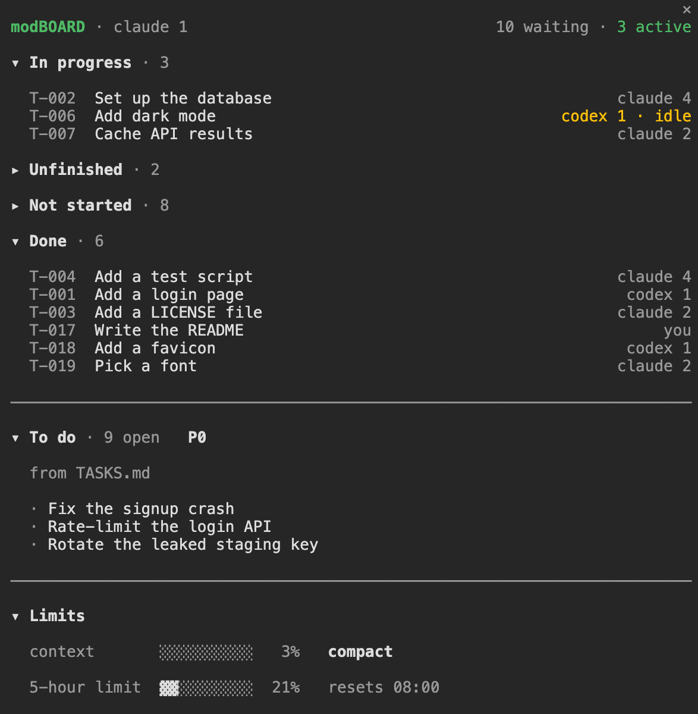
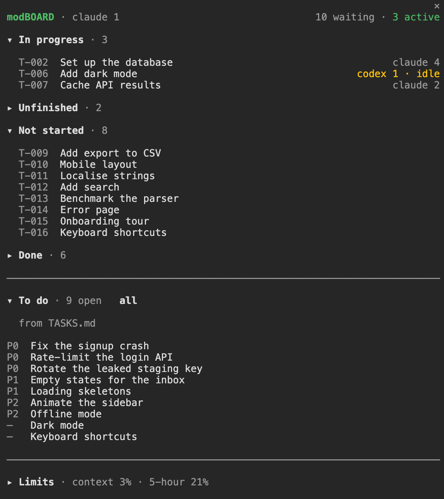
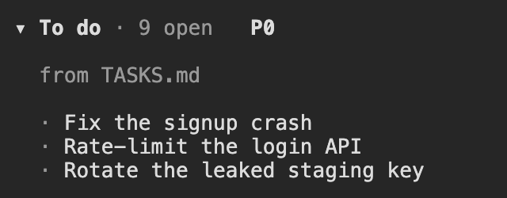
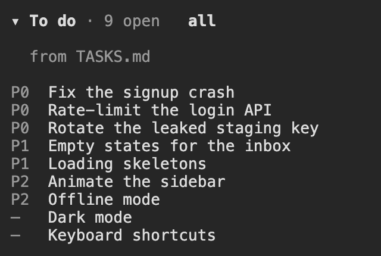
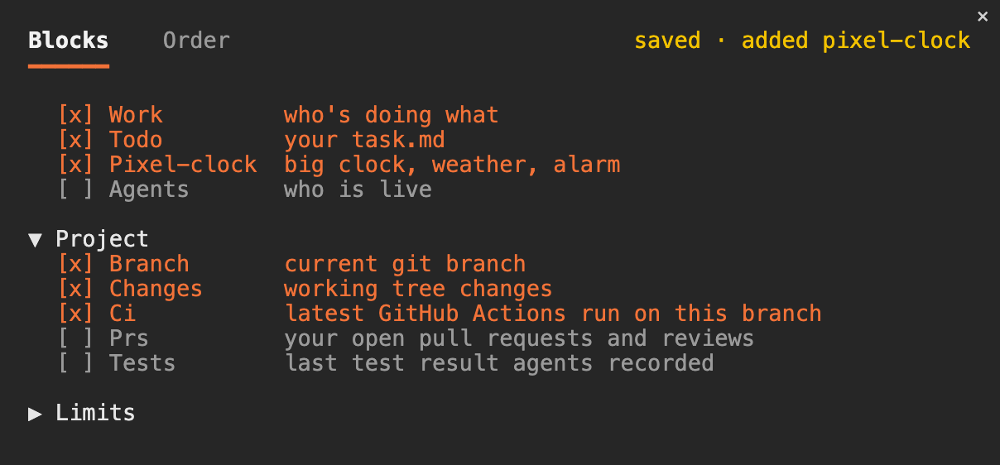
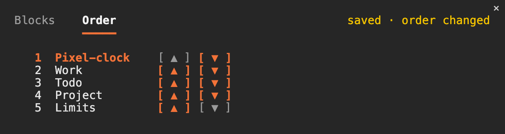
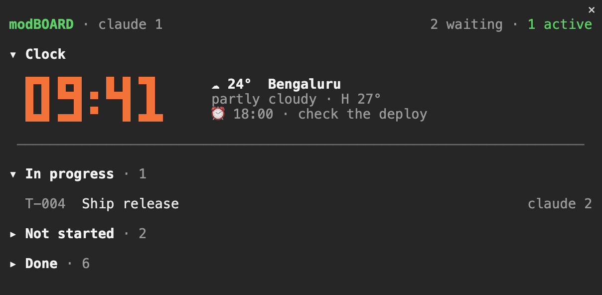

# modBOARD tutorial

modBOARD is one board for every agent and every person, and you decide
what's on it. This walks you from nothing to two agents sharing one board, in
about fifteen minutes. You'll install the CLI, run a board by hand, open it in
Claude Code, hand work from one session to another, read your project's own
task list on the board, and then choose what the board shows, including a
block of your own.

You need Node 18 or newer, git, and (for parts 3 onward) Claude Code
2.1.295 or newer.

**Contents**

1. [Install the CLI](#1-install-the-cli)
2. [Your first board, by hand](#2-your-first-board-by-hand)
3. [Open the board in Claude Code](#3-open-the-board-in-claude-code)
4. [Two sessions, one board](#4-two-sessions-one-board)
5. [Reading the board](#5-reading-the-board)
6. [Your task.md on the board](#6-your-taskmd-on-the-board)
7. [Adding Codex or any other agent](#7-adding-codex-or-any-other-agent)
8. [Making the board yours](#8-making-the-board-yours)
9. [When something looks wrong](#9-when-something-looks-wrong)

---

## 1. Install the CLI

Every agent, Claude Code included, works the board through one command,
`board`. Install it from npm:

```bash
npm install -g modboard
```

Or from a clone, if you want the Claude Code mod too (part 3 needs the
folder):

```bash
git clone https://github.com/Magithar/modboard.git
cd modboard && npm link
```

Check it's on your PATH:

```bash
board list
```

Outside a board it answers `(no open tasks)`. That's fine: a board is made
the first time you add to it.

---

## 2. Your first board, by hand

Go to any git repository. The board lives in `.modboard/` at the repo's
root, shared by every worktree of the repo. Keep it out of git, because it's
runtime state:

```bash
cd ~/code/my-app
echo ".modboard/" >> .gitignore
```

### Add tasks

Give a task acceptance criteria when you can: it's how whoever finishes it
will show it's done.

```bash
board add "Add a login page" --accept "visiting /login shows a form that signs in"
board add "Write the README"
board add "Add dark mode"
```

```
added ○ T-001  Add a login page
added ○ T-002  Write the README
added ○ T-003  Add dark mode
```

### Say who you are

Every change to the board is made by someone. Claude and Codex sessions are
named for you (`claude 1`, `codex 1`); from your own terminal, set your name
once:

```bash
export BOARD_AGENT=frontend
```

Forget it, and the board asks: `board: who are you? pass --as <agent> or
set BOARD_AGENT`. You can also pass `--as <name>` on any command.

### Claim, note, release

Claim a task before working on it. Only one claim wins:

```bash
board claim T-001
```

```
claimed T-001  Add a login page
it's yours until 17:33; a note or heartbeat renews it
```

If someone else tries now, they're refused, and the refusal is recorded:

```bash
BOARD_AGENT=backend board claim T-001
```

```
board: T-001 is already claimed by frontend until 17:33
```

A claim is a lease of 15 minutes. Each note renews it, so record progress as
you go:

```bash
board note T-001 "form renders; sign-in call next"
```

Before you stop, record the last check that passed. The board runs it in
your checkout and records it only if it passes, with the commit it ran at:

```bash
board check T-001 "npm test"
```

```
checked T-001: npm test passed at 4f2a9c1; yours until 12:03
```

If you stop before finishing, release the task with a **handoff**: what's
done, what's left, where to look. The board adds the worktree, branch and
commit you're in, and the files your work changed. The next agent starts from it.

```bash
board release T-001 --handoff "form done in src/login.tsx; sign-in call not wired yet, see api/auth.ts"
```

```
released T-001 with a handoff; it's back to todo
the work is in /code/app-login · login @ 4f2a9c1, uncommitted changes
```

### Pick up someone's work

Before resuming a task, read it:

```bash
board show T-001
```

```
○ T-001  Add a login page

Accept when: visiting /login shows a form that signs in

- [2026-11-19T11:48] frontend: form renders; sign-in call next
- [2026-11-19T11:48] frontend: CHECKED: npm test (run by the board, passed)
    in /code/app-login · login @ 4f2a9c1
    files: src/login.tsx
- [2026-11-19T11:48] frontend: HANDOFF: form done in src/login.tsx; sign-in call not wired yet, see api/auth.ts
    in /code/app-login · login @ 4f2a9c1, uncommitted changes
    files: api/auth.ts, src/login.tsx
```

Work in that worktree, on that branch. The tests passed at `4f2a9c1`, before
the uncommitted changes, so run them again before you build on them.

### Who changed this file?

Each handoff and check keeps the files its work changed, so you can ask the
board who touched a file before you edit it:

```bash
board who api/auth.ts
```

```
T-001  Add a login page  · frontend · handoff 11:48 · /code/app-login · login @ 4f2a9c1, uncommitted changes
```

The latest first. Claude agents ask the same with the `board_who` tool.

### Done means verified

`done` refuses without a note saying how you checked the work, against the
task's acceptance criteria:

```bash
export BOARD_AGENT=backend
board claim T-001
board done T-001
```

```
board: done needs --note saying how you verified T-001 against: visiting /login shows a form that signs in
```

```bash
board done T-001 --note "ran the app, signed in at /login, landed on /home"
```

```
done ● T-001  Add a login page
VERIFIED: ran the app, signed in at /login, landed on /home
```

`board list` shows what's open, and `board list --all` includes what's done:

```
● T-001  Add a login page
○ T-002  Write the README
○ T-003  Add dark mode
```

`○` is todo, `◐` claimed, `●` done.

---

## 3. Open the board in Claude Code

The Claude Code mod gives a session the board's tools, a line above the
prompt, and a `/board` pane. The line and the pane are both made of blocks you
can change later ([part 8](#8-making-the-board-yours)). Start a session with
the mod:

```bash
cd ~/code/my-app
claude --plugin-dir /path/to/modboard
```

`/path/to/modboard` is the clone from part 1. The board names the session
`claude 1`, and the `/board` pane's top line says so. To pick a name
instead, start it with `BOARD_AGENT=frontend`.

Now ask Claude to work the board, in plain words:

> Look at the board and do the next task.

Claude lists the tasks, claims one before writing any files, notes its
progress, and marks it done with a note on how it checked. You don't need
to teach it the protocol: the tools describe it.

Type `/board` to open the pane beside the conversation. It updates every
few seconds.

---

## 4. Two sessions, one board

Open a second terminal in the same repository, or in a worktree of it.
Worktrees share the board:

```bash
claude --plugin-dir /path/to/modboard
```

This one is `claude 2`. Each session's `/board` pane names it at the top
(`modBOARD · claude 2`), so you can tell the terminals apart. Tell both
sessions to work the board. What you'll see:

- **They never do the same task.** If both go for T-002, one claim wins;
  the other session is refused, says who holds it, and takes another.
- **Work survives a stop.** If you stop `claude 1` partway, or tell it to
  hand off, it releases with a handoff. The line above `claude 2`'s prompt
  shows *T-002* in a yellow box, and `claude 2` reads the
  handoff before resuming. In `/board` the handoff shows `where` (branch and
  commit), `path` (the worktree; click it to copy a `cd` to it) and `check`
  (the last check that passed).
- **A crashed session doesn't hold work hostage.** If a session is killed
  outright, its claims come back after its session has been silent for 3
  minutes. A plain CLI agent's claim comes back when its 15-minute lease
  runs out. If it had noted progress or recorded a check, the task waits
  under Unfinished, with the last place its work was seen, marked *last
  known, may be stale*.
- **Names don't collide.** A third session becomes `claude 3`. If you name
  sessions yourself and start a second `frontend` while the first is live,
  the new one becomes `frontend-2` and says so.

When a session ends normally (exit, `/clear`), it releases what it holds,
with a handoff note saying it ended and the worktree it was in.

---

## 5. Reading the board

This part shows the default blocks. With them, the display shows what needs
you and is quiet otherwise. Colour means one thing: **yellow or red, look
here.**

### The line above the prompt

```
2 waiting · 1 active   [T-005]   Sonnet 5.5   low   blocks   modBOARD
```

| Part | Says |
|---|---|
| `2 waiting · 1 active` | the board at a glance; `active` is green |
| `[T-005]` | a yellow box: click it to open `/board` at the Unfinished group, again to fold it; the one thing that needs you: work someone handed off and nobody has picked up |
| `blocks` | in orange, opens the pane at the list of blocks, to choose what the board shows ([part 8](#8-making-the-board-yours)); click it again to close the pane |
| `modBOARD` | in green, opens the `/board` pane, like typing `/board`; click it again to close the pane |
| `Sonnet 5.5   low` | the session's model and effort. Click either to switch to the next one |

The 5-hour limit and the context are in the `/board` pane, where both bars
turn yellow at 70% and red at 90%. In a narrow window the line shortens and
drops parts from the right; the yellow boxes are the last to go. With nothing
waiting or in progress, it disappears.

### The `/board` pane

```
 modBOARD · claude 1               13 waiting · 3 active

 ▾ In progress · 3

   T-004  Add a test script                          you
   T-007  Write the README                      claude 2
   T-006  Add a LICENSE file                codex 1 · idle

 ▾ Unfinished · 1

   T-005  Ghost task                            claude 3
          · layout done
          · saving isn't wired yet

          where  settings @ 4f2a9c1, uncommitted changes

          path   ~/code/app-settings

          files  src/settings.tsx, src/settings.css

          check  npm test passed at 4f2a9c1, before uncommitted changes

 ▸ Not started · 12

 ▸ Done · 3

 ───────────────────────────────────────────────────────

 ▸ To do · 6 open   P0

 ───────────────────────────────────────────────────────

 ▾ Limits

   context       ▓▓▓▓▓▓▓░░░  72%   compact

   5-hour limit  ▓▓▓▓▓▓░░░░  64%   resets 12:00
```

<table>
  <tr>
    <td></td>
    <td></td>
    <td></td>
  </tr>
  <tr>
    <td align="center">As it opens</td>
    <td align="center">Done and To do opened</td>
    <td align="center">Not started, every priority, Limits folded</td>
  </tr>
</table>

- **The headings say what's happening; each row says who.** Your own tasks
  are bold.
- **Yellow rows need you**: an agent gone idle (`codex 1 · idle`: no note or
  heartbeat for most of its lease), or work stopped partway that nobody has
  picked up.
- **Each heading is a button.** Click it to open or close the group. In
  progress and Unfinished start open, because they need you; Not
  started starts closed, so the board fits on screen. Opened, it shows every
  task.
- **The bars sit under Limits**, a heading that folds like the others.
  Folded, it keeps the figures, `▸ Limits · context 72% · 5-hour 64%`, in
  the bars' colours, so a limit running out still shows.
- **The compact button is always there** while Limits is open, beside the context bar. Before
  Claude's first reply the bar shows Claude Code's own estimate; after it,
  the measured fill.
- **If the pane is shorter than the board**, scroll its body with the mouse
  wheel.

---

## 6. Your task.md on the board

If your repository keeps a task list in a markdown file, the `todo`
block shows it in the pane, beside the board's own tasks. It's found when it's called `task.md`, `tasks.md` or
`todo.md` (any capitals), at the repo's root or in `docs/`.

Say `TASKS.md` reads:

```markdown
# Sprint

## P0 — launch
- [ ] Fix the signup crash
- [ ] Rate-limit the login API

## P1 — polish
- [ ] Empty states for the inbox
- [x] Favicon
- [ ] P2 Animate the sidebar

## Later
- [ ] Dark mode
```

The pane shows one line:

```
 ▸ To do · 5 open   P0
```

Click `To do` to see what's left. Opened, a dim line under it names the
file it read (`from TASKS.md`). Checked-off items stay in the file and out
of the pane.

### Priorities

When the file has priorities, the second button turns through them, the way
the effort button turns through levels. It starts on the most urgent. Each
press shows the next tier, then `all`, then round again:

```
 ▾ To do · 5 open   P0               ▾ To do · 5 open   P1

   from TASKS.md                     from TASKS.md

   · Fix the signup crash            · Empty states for the inbox
   · Rate-limit the login API
```

```
 ▾ To do · 5 open   all

   from TASKS.md

 P0  Fix the signup crash
 P0  Rate-limit the login API
 P1  Empty states for the inbox
 P2  Animate the sidebar
 –   Dark mode
```

In `all`, every row shows its own priority, so each line is one task. Items
with no priority come last, marked with a dash.

In a real session, with a longer `TASKS.md`, it looks like this:

<table>
  <tr>
    <td valign="top"></td>
    <td valign="top"></td>
  </tr>
  <tr>
    <td align="center"><code>P0</code>: the most urgent tier</td>
    <td align="center"><code>all</code>: every item, by priority</td>
  </tr>
</table>

Priority is read wherever your file keeps it:

| Where | Looks like | Applies to |
|---|---|---|
| a heading | `## P0 — launch` or `## Sync (P1)` | every item under it |
| an item | `- [ ] P2 Animate the sidebar` | that item, over its heading |
| a table | a `Priority` column beside a `Task` column | that row |

A table row counts as done when its `Status` says done, complete or ✅.
Struck-through items (`~~old plan~~`) count as done too. Once a file checks
anything off, its plain bullets are read as notes, not tasks.

### From the shell

```bash
board taskfile
```

```
TASKS.md
[ ] P0 Fix the signup crash
[ ] P0 Rate-limit the login API
[ ] P1 Empty states for the inbox
[x] P1 Favicon
[ ] P2 Animate the sidebar
[ ] Dark mode
```

### It's read-only

The board shows your task file but never writes it, and its items can't be
claimed. To have agents work an item, put it on the board:

```bash
board add "Fix the signup crash" --accept "signing up with a new email lands on /welcome"
```

---

## 7. Adding Codex or any other agent

Anything with a shell can share the board: Codex, OpenCode, a script, you.
Codex needs no name: the board names each Codex thread by when it joined,
`codex 1`, then `codex 2`. Anything else gives each session its own name
(`export BOARD_AGENT=opencode`). Then put the protocol in its instructions
(`AGENTS.md`):

> Use the `board` CLI to coordinate. Claim a task before working on it
> (`board claim T-001`). Note progress (`board note T-001 "..."`). Record
> checks that pass (`board check T-001 "npm test"`). If you stop
> without finishing, release it with a handoff (`board release T-001
> --handoff "done X; left Y; see Z"`). Finish with `board done T-001 --note
> "how you verified it"`. Never touch a task another agent holds.

A CLI agent has no automatic heartbeat. Its notes renew its lease, or it can
run `board heartbeat` on long work.

For scripts, add `--json` to any command for data instead of sentences.
`board view` prints every task and live agent as JSON in one call. Exit
codes: 2 usage, 3 board busy, 4 no such task, 5 not yours, 6 held by another
agent, 7 name in use.

---

## 8. Making the board yours

The board is built from blocks: the task groups, your task file, the model,
the limits. Everything you've seen so far is the default set. You decide which
blocks show, in what order, and you can add your own. In Claude Code, the
mod's settings are under `/config`.

### Choose what shows

Two settings list the display's blocks, in order:

| Setting | Default | Also available |
|---|---|---|
| Band blocks (the line) | `summary,model,effort,board` | `usage`, `compact`, `clock`, `pixel-clock`, `weather`, `context` |
| Pane blocks (`/board`) | `work,todo,compact,usage` | `agents`, `pixel-clock`, `model`, `effort`, `clock`, `context` |

The band's order is its order of importance: when the line is short, the
last blocks go first, so model and effort are the first to drop. Clicking
them steps through the **Models to switch between** and **Effort levels to
switch between** settings. Leave them out of the band if you'd rather not
see them; Claude Code shows both in its own header too.

For the pane there's a quicker way: click **blocks** on the band. The pane
turns to a list with two tabs. On **Blocks**, a click ticks a block on or off;
the groups below, `▶ Project` and `▶ Limits`, open or fold with a click.
On **Order**, the ticked blocks are numbered in the board's order, and **▲**
and **▼** move one a place. Each click is saved as it's made, and the right
of the tabs says what changed (`saved · added agents · order changed`). Click
`modBOARD` to see the board.

<table>
  <tr>
    <td></td>
    <td></td>
  </tr>
  <tr>
    <td align="center">Blocks</td>
    <td align="center">Order</td>
  </tr>
</table>

### Clock, weather and an alarm

Tick `pixel-clock` and the pane gets a big clock under a `▾ Clock` heading,
the weather and the next alarm beside it:



- **Weather.** Ticking the clock asks once where you are: your city from
  your IP, a city you type, or not now. Nothing is sent before you answer.
  `/board location` asks again, or set **Weather location** in `/config`.
- **An alarm of your own**: `/board alarm 7:30` (every day), `/board alarm`
  to list, `/board alarm off` to clear. Or ask Claude: "remind me at 6pm to
  check the deploy" rings once, with that note, and "turn off the alarm"
  clears them.
- **When important work is done**: `board add "Ship release" --ring`, or
  `board ring T-004` for a task already on the board. When it turns done,
  whoever finishes it, the clock chimes and shows `⏰ T-004 done · Ship release`.

The alarm rings while a Claude Code session with the mod is open.

### Your own blocks, no code

**Your own blocks** maps a name to a shell command. Every 30 seconds the
command runs, and the block shows the first line it prints:

```json
{
  "ci": "gh run list -L1 --json conclusion -q '.[0].conclusion'",
  "branch": "git branch --show-current"
}
```

With them set, the pane shows them under one **Project** heading, with
nothing to tick, a success in green and a failure in red:

```
 ▾ Project

   ci       success
   branch   main
```

For the band, add the names to the band setting, like a built-in block:

```
summary,ci,branch,model,effort,board
```

The band now reads `ci success` and `branch main` beside the work. A name is
lowercase letters, digits and dashes, up to 16 characters, and can't be a
built-in block's name.

A command that fails keeps its last good result. Under Project, a result
older than 5 minutes says its age (`12 min ago`); once the command has failed
for 5 minutes, it says `not updating since 14:02` in yellow. The `stale`
setting changes the 5 minutes.

This setting lives in your user config, never the project's, so opening
someone else's repo can't make your session run its commands.

For blocks in code, or a storage block that keeps the board somewhere other
than a folder, see [Make your own block](../README.md#make-your-own-block).

---

## 9. When something looks wrong

| You see | Why | Do |
|---|---|---|
| `who are you? pass --as <agent>` | no name | `export BOARD_AGENT=yourname` |
| `already claimed by X until 17:33` | another agent holds it | pick another task; it comes back if X stops |
| `T-001 is not claimed by <your name>` | you're noting, releasing or finishing a task you don't hold | `board claim` it first |
| `done needs --note` | done means verified | say how you checked it |
| a session named `frontend-2` | `frontend` is live in another session | give each session its own name |
| no task file line in the pane | no `task.md`, `tasks.md` or `todo.md` at the root or in `docs/` | check the name and place |
| no priority button | the task file has no `P0`–`P9` | add priorities to headings or items |
| a block of your own shows nothing | its command failed or printed nothing | run the command in a shell from the repo |
| a toast says a block was skipped | its name is invalid or a built-in's | rename it in **Your own blocks** |
| the board seems out of step | | `board doctor` checks the ledger against the state |

`board where` prints which folder holds the board. `board doctor` should end
with `ok: the ledger and the state agree`.

That's everything. The [README](../README.md) covers how it fits together,
and [CHANGELOG](../CHANGELOG.md) what changed in each version.
